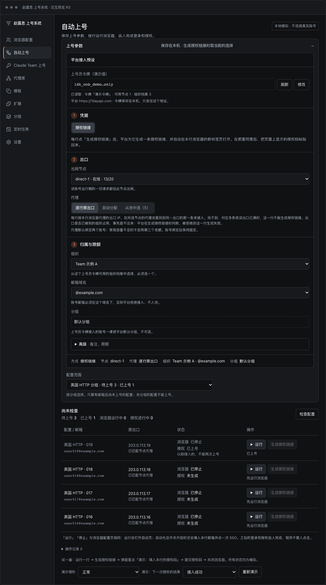
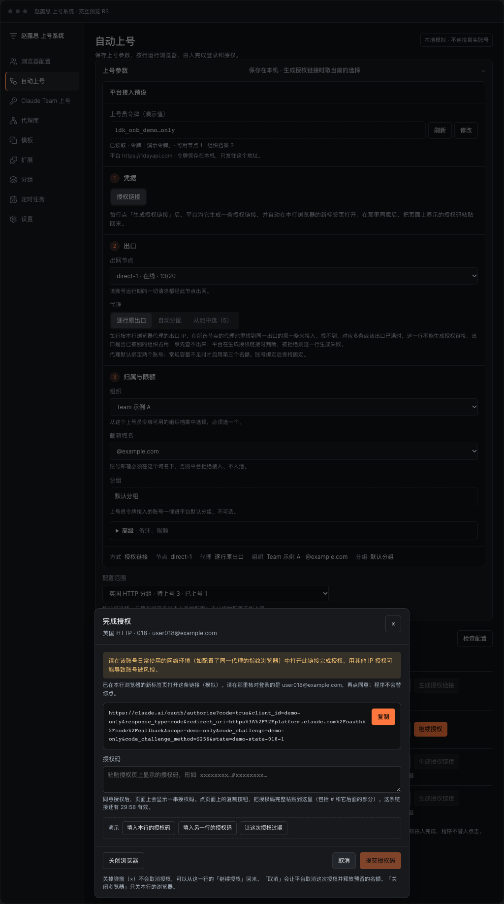
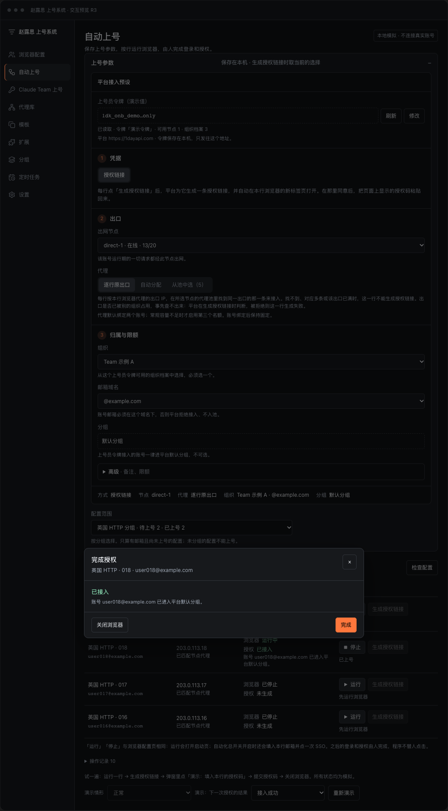
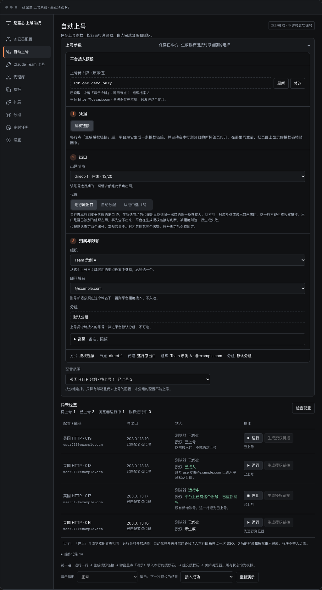
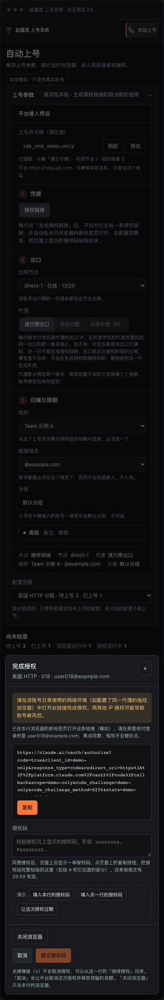
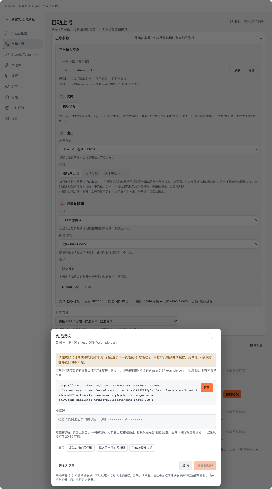

# 上号：上号参数、运行与手动授权设计（原「自动上号」方案）

日期：2026-11-22 起草，2026-11-23 修订为 R3。状态：第一阶段「上号参数」和第二阶段 R3 的「运行、生成授权链接、完成授权」都已实现并提交（9.1、9.2）；只在替身平台上验证过，没有用真实的上号员令牌和真实平台验证。源码基线：camoufox-profile-manager-custom `90b39a2`，实现在它之后提交；1dayapi `main`（`a19e33e`）。1dayapi 只读，不能修改。

**R3 的变化（用户 2026-11-23 决定）：不做自动上号。** 程序不再替人在浏览器里登录、点击授权、读取回调，也没有串行批次。改为：

- 每行一个「运行 / 停止」按钮，逻辑与「浏览器配置」页的相同；
- 每行一个「生成授权链接」按钮，点击后平台生成授权链接，程序自动在本行浏览器的新标签页打开它，并弹出「完成授权」：人在那个标签页里同意，再把页面上显示的授权码粘贴回来提交；
- 弹窗里加一个「关闭浏览器」按钮，关闭本行打开的浏览器。

**粘贴回来的是授权码，不是回调地址（用户 2026-11-23 指出）。** 同意授权后，页面上显示一串授权码（形如 `授权码#state`），人复制它粘贴到「完成授权」弹窗的「授权码」一栏，点「提交授权码」。平台接口里接收它的字段叫 `callbackUrl`，本文说「提交回调」「回填回调」的地方指的是调用这个接口；页面上一律叫授权码。

上号参数（第 4 节）不变。交互原型已按 R3 更新（8.3）。R2 为自动批次写的内容已从本文删除：共享 SSO 步骤、专用执行器、队列与恢复、人工接管、SSO 密码、要 1dayapi 新增的能力，以及原型的执行界面说明。删除前的全文在本机留有备份 `var/scratch/design.before-manual-flow.md`（该目录不进版本库）。

示例数据全部使用虚构邮箱与地址，真实密码、令牌、授权码、Cookie 不进入文件。

## 1. 要解决的问题

用户已经手工完成模板、批量配置和邮箱导入，要把这些配置里的 Claude 账号接入 1DayAPI。上号页做三件事：

1. **保存上号参数**：上号员令牌，以及接到哪个节点、走哪条代理、归哪个组织、限额多少（已实现）。
2. **按行运行和停止浏览器**：人在本行浏览器里登录 Claude。
3. **按行完成授权**：向平台要一条授权链接，人在本行浏览器里同意授权，把页面上显示的授权码粘贴回来，平台据此把账号接入；之后关闭浏览器。

不做的事：程序在 Claude 或登录页上填写和点击；程序打开授权页后代人同意；程序读取回调地址或授权码；一次启动多行的批次、排队、暂停、接管与恢复；保存 SSO 密码。

有一点是「逻辑与浏览器配置页相同」带来的，不是本页新增的：「运行」会像现在一样打开启动页，自动化总开关开启时还会填入本行邮箱并点一次 SSO（见 2.1）。之后的登录、引导和授权都由人完成。

## 2. 源码已经具备什么

以下路径相对于对应仓库，本项目后端路径位于 `src/camoufox_pm`；行号是 2026-11-23 核对时的位置。

| 位置 | 核实的事实 | 对设计的影响 |
| --- | --- | --- |
| 本项目 `web/src/components/app-shell.tsx:13`、`:15` | 左侧菜单和角色路由白名单；第一阶段已加入「自动上号」一项 | 菜单已有；R3 之后是否改名见第 11 节 |
| `web/src/app/page.tsx:375`、`:389`、`:941` | 浏览器配置页的 `launch`、`stop` 和「运行 / 停止」按钮：启动前把本行邮箱复制到剪贴板；按钮在处理中、没有启动权限、或同步阻止启动时不可用；每 5 秒读一次运行中的浏览器 | 上号页的按钮用同一套处理；建议抽成两页共用的一段，避免两处走样 |
| `web/src/lib/api.ts:428`、`:435` | `startProfile` 调 `POST /profiles/{id}/launch`（`{headless:false}`），`closeProfile` 调 `POST /profiles/{id}/close` | 直接复用，不新增启动或关闭接口 |
| `api/routes/profiles.py:437`、`:464`、`:1073`、`:1107` | 启动校验该配置的启动权限；新启动、非无头且有启动页时打开启动页，总开关开启才传邮箱；关闭未运行的配置是空操作；`GET /browsers/active` 返回运行中的配置 | 「逻辑一样」就是调用这些接口，启动页的辅助随之照旧 |
| `core/browser_session.py:330`、`:766` | `_sign_in_with_sso` 填邮箱并点一次 SSO；`open_start_page` 在后台执行它 | 不改。本页不在它之上增加任何页面操作 |
| `core/app_settings.py:62` | `automation_enabled(storage)`：数据库里的总开关，环境显式值优先并锁定 | 只影响「运行」之后是否填邮箱、点 SSO；不影响生成授权链接和提交回调 |
| `core/profile_manager.py:995`、`:1179` | `launch_browser` 走准入与租约，已在运行时不重复启动；`close_browser` 关闭并释放 | 沿用 |
| `core/models.py:299` | 配置有 email、group、proxy、proxy_check | 行数据的来源；本行出口 IP 取 `proxy_check.ip` |
| `core/onboarding.py:445`、`:483`、`:498` | `OneDayClient` 以 Bearer 调 `/api/onboard/*`；`submit` 只会提交 sessionKey；`job` 能查询作业 | 要补三个调用：以 `auth_url` 创建作业、回填回调、取消作业 |
| `core/auto_onboarding/scopes.py:13` | `_onboarded()` 恒为假：第一阶段没有已上号记录 | 第二阶段改为读本地已上号记录 |
| `api/routes/onboarding.py` | 旧「Claude Team 上号」：预填邮箱、新建配置、读取 sessionKey | 保留原用途，不与本页混用 |
| 1dayapi `apps/console/src/routes/onboarder.ts:174`–`:247`、`:322` | `POST /api/onboard/jobs`：`method:"auth_url"` 创建作业并返回 `authorizeUrl`；同一路径带 `jobId` 和 `callbackUrl` 时回填回调 | 生成授权链接和提交回调要用的接口已存在 |
| 同上 `:323`、`:336` | 取消作业、查询单个作业；令牌只能操作它自己创建的作业 | 取消和查询已存在 |
| `apps/console/src/onboard/jobs.ts:110`–`:146` | 查询结果含 `status`、`expiresAt`、`accountId`、`accountEmail`、`reused`、`cooldownUntil`、`error`（上号员只看到错误码）和 `authorizeUrl` | 授权链接可以随时向平台再取，本机不必保存 |
| 同上 `:212` | `callbackUrl` 接受 `code#state`（平台源码注明这是官方回调页展示的格式）、完整回调地址或只有授权码；带 state 时必须与本作业一致 | 人粘贴的是页面上显示的 `code#state`；把别的行的授权码粘贴过来会被平台拒绝 |
| `apps/console/src/onboard/reservations.ts:3`、`:4`、`:87` | 等待回调最长 30 分钟，提交后处理最长 3 分钟；过期分别记为 `callback_expired`、`job_expired` | 页面显示剩余时间；过期后重新生成 |
| `apps/console/src/onboard/jobs.ts`（组织发现后的出口重选；同归属 error 账号的原地重授权） | 未指定组织时平台可能把账号改接到别的出口；已有的 error 账号会被原地重新授权 | 不改 1dayapi 就改变不了，作为已知限制写明（第 11 节） |

配置名称不是登录身份，必须读配置的 email。成功只认平台作业的 `done`；拿到作业号、提交授权码返回 200、状态为 `working` 都不是成功。

### 2.1 「运行」和「停止」现在做什么

```text
运行 → POST /profiles/{id}/launch → manager.launch_browser（准入、租约）
  → 仅新启动、非无头、有启动页（默认 https://claude.ai）时打开启动页
  → 自动化总开关开启：填入本行邮箱 → 等待 SSO 按钮 → 点击一次 → 辅助结束
  → 之后全部由人操作
停止 → POST /profiles/{id}/close → 关闭该配置的浏览器并释放租约
```

辅助点击 SSO 之后就结束：不确认是否到达登录页，不填密码，不处理后面的页面。总开关关闭时只打开启动页。已经在运行的配置再点「运行」不会新开窗口，也不会再打开启动页。

运行状态属于配置，不属于某个页面：同一个配置在「浏览器配置」页和上号页显示同一个状态，在任一页运行或停止，另一页随之变化（两页各自每 5 秒读一次）。

## 3. 方案取舍

| 方案 | 做法 | 结论 |
| --- | --- | --- |
| R2 自动批次 | 程序串行处理每一行：登录、引导、打开授权页、同意、取回调、提交、关窗 | **用户决定不做。** 它还依赖没有看全的 Claude 登录后页面，以及要改 1dayapi 才有的保障，而 1dayapi 不能修改 |
| **R3 手动授权** | 每行由人运行浏览器并登录；点「生成授权链接」，在弹窗里粘贴授权码并提交；关闭浏览器 | **采用** |
| sessionKey 接入 | 登录后读取 Cookie，提交给平台 | 不采用。旧「Claude Team 上号」保留它现有的用途 |

R3 与 1DayAPI 上号员站点上的「生成授权链接 → 完成授权」是平台上的同一套流程，调用的是同一组接口。本页相比在那个站点上手工操作，多出的是四点：

- 节点、代理、组织和限额取自本机保存的上号参数，不用每次重选；账号名称固定为本行邮箱。
- 代理可以按本行浏览器的出口匹配（「逐行原出口」），那个站点上只能自动分配或手选。
- 授权链接生成后自动在本行的浏览器里打开，不用复制到别处，避免用错网络环境。
- 结果记回这一行：已上号的配置不会再生成授权链接。

**自动化总开关。** 本页不新增开关，也不读它来决定按钮能不能点。它只像现在一样决定「运行」之后是否自动填邮箱并点 SSO。生成授权链接（连同随之在本行浏览器里打开这条链接）、提交授权码、取消和关闭浏览器都是人点击后才发生的单次操作，不受总开关影响。

## 4. 数据准备如何衔接

不自动创建模板、配置、邮箱、平台节点、组织或代理。已有的手工准备操作继续存在。

上号参数保存在本机（第一阶段已实现）：1dayapi 没有保存这些选择的地方，也不能为此修改。R2 首版设想的平台端「保存接入预设」已放弃。

本节的「必要输入」「配置范围」「已上号」三处已按 R3 重写。「接入预设的数据来源」一小节保留 R2 期间逐步确认的原文，上号参数本身没有变；读这一小节时注意四处说法：

- 「开始」「批次」「队列表」是 R2 的说法，R3 没有批次。原文说「检查配置和开始被拒绝」的地方，R3 对应「检查配置」和每行的「生成授权链接」被拒绝；说「整批共用」的地方，对应「所有行共用这一个选择」。
- 「批次运行期间令牌一行锁定」「按第 6 节暂停批次」不再适用。有授权尚未结束时能否更换令牌，见本文第 6 节。
- 原文引用的「第 7 节推荐补齐的远端能力」（`lockProxy`、`expectedExitIp`、`existingAccountPolicy`、按邮箱预查等）都要改 1dayapi，已整体放弃，第 7 节不再列出；由此带来的限制见第 11 节。
- 「SSO 密码」已不存在。

### 必要输入与默认项

| 输入 | 来源与约束 |
| --- | --- |
| 配置范围 | 只按分组选择，未分组的配置不可选；分组后的数量只算有邮箱且未上号的配置。见下文「配置范围的数据来源」 |
| 平台连接 | 地址默认为 https://1dayapi.com。用户已确认：接入预设的数据和授权作业都走**上号员令牌**（`1dk_onb_…`，Bearer，`/api/onboard/*`），不使用管理员登录密钥和管理 Cookie 会话；见下文「接入预设的数据来源」。令牌不进前端存储 |
| 上号参数 | 保存在本机：节点、代理方式、组织与邮箱域名、备注和限额。生成授权链接时取当时保存的值 |
| 授权码 | 同意授权后页面上显示，人复制后粘贴到「完成授权」弹窗；只转交给平台，本机不保存 |
| 自动化总开关 | 现有设置。只决定「运行」之后是否自动填邮箱并点 SSO，本页不用它决定按钮是否可用 |

R2 输入表里的 authentik 密码、登录地址、登录后引导资料、执行策略四项随自动批次删除。

（以下一段写于改走上号员令牌之前，保留作为管理员通道的备忘；当前方案不建立管理员连接。）平台管理员连接只开放给本机管理员。未来给操作员开放时，优先增加「预设受限的自动上号凭据」并沿用既有授权边界；不能直接让操作员继承管理员连接、任意更改归属或读取全量组织。原有 `/api/onboard/*` token 的节点/组织范围和归属规则，与管理员控制台的全部可选项不等价，不作为透明替换。

### 接入预设的数据来源：上号员令牌

用户已确认接入预设卡片的数据走上号员令牌。**用户随后明确：1dayapi 不能修改。** 所以上号参数只使用 1dayapi `main`（`0f0ff15`）现有的上号员令牌接口，凡是要平台新增或改动才能做到的，都不放进上号参数。按这个约束逐项核对过，上号参数里只有「归属分组可选」一项做不到，已改回固定的默认分组；其余各项用到的接口都已存在（见本小节末尾「不改 1dayapi 时上号参数的核对结果」）。下表逐项对照卡片内容与 1dayapi `main` 的令牌接口。表里对照的是改动前的卡片；用户随后确认按令牌通道修改，改后的卡片见表后「已按令牌通道修改的五处」和第 8 节。

| 卡片内容 | 令牌通道的数据来源 | 结论 |
| --- | --- | --- |
| 凭据「授权链接」 | 创建作业时 `method:"auth_url"`，返回 `authorizeUrl` | 支持。本项目客户端目前只会提交 sessionKey，要补创建、回填、取消三个调用 |
| 出网节点「direct-1 · 在线 · 13/20」 | `/api/onboard/me` 的 `nodes`：`name`、`online`、`used/capacity` | 支持，本项目已转发。只含平台自有节点；令牌绑定了某个节点时只有那一个 |
| 代理「自动分配」 | `proxyId:"auto"` | 支持 |
| 代理「从池中选（20）」 | `/api/onboard/proxies?nodeId=`，条数即括号里的数字，每条带 `exitIp` | 支持，本项目已转发。提交时传该条的 `id` |
| 代理「自带代理」 | 无 | **不支持。** 自带代理的解析与入池接口只对管理员和供应方会话开放 |
| 代理的「分组 · 不限分组」 | `/api/onboard/node-groups?nodeId=`，提交 `proxyGroup` | 支持，本项目已转发。只在自动分配时生效 |
| 组织 | `/api/onboard/me` 的 `orgs`（组织档案，不含 UUID），提交 `orgId` | 支持，但规则和卡片现状不同，见下 |
| 组织「手动输入 UUID」 | 请求体 `orgUuid` | 仅当这个令牌看不到任何组织档案时才生效；选了档案时以档案的 UUID 为准 |
| 归属「分组 · 默认分组」 | 无 | **不可选。** `groupId` 只有管理员通道接受；令牌上的号一律进平台默认分组 |
| 高级 · 名称、备注 | `name`（最长 80）、`note`（最长 500） | 支持。批量时所有行共用一个名称没有意义，旧流程用的是每行的邮箱 |
| 高级 · 并发上限、RPM 上限 | `concurrencyLimit`、`rpmLimit` | 支持。留空或 0 时用平台默认值 |
| 高级 · 账号之间的间隔 | 无 | **没有对应参数。** 它只是 1DayAPI 网页在多条 sessionKey 之间的等待 |
| 摘要一行（最初在卡片顶部，现在在「归属与限额」下面） | 由以上选择拼出 | 不需要接口 |

组织的实际规则（改动前的卡片没有体现）：

- 只要这个令牌能看到至少一个组织档案，创建作业就**必须**带 `orgId`，否则以 `org_required` 拒绝；这时「不指定」不可用，手动输入的 UUID 也不起作用。
- 选中的档案如果配置了邮箱域名，还必须带 `domain`，且必须是档案里的域名之一；作业完成时账号邮箱不在该域名下会以 `domain_mismatch` 失败、不写入账号。改动前的卡片没有域名这一项。
- 令牌被限定了组织、而这些组织全部被停用或删除时，令牌不可用。
- 「不指定」在组织与出口绑定开启时要求一个尚无账号的出口：自动分配会去找这样的出口，指定了已有账号的代理则以 `needs_virgin_exit` 拒绝。

已按令牌通道修改的五处（用户已确认，原型已改）：

1. 删除「自带代理」。当时代理方式还剩「自动分配」和「从池中选」，随后也已去掉（见下文「代理改为逐行原出口」），后来又按用户要求加回（见「代理改回可选，归属分组保持固定」）。「自带代理」一直没有加回。
2. 归属分组改为固定文字「默认分组」，写明不可选。后来一度按用户要求改成下拉，因为 1dayapi 不能修改又改回固定文字，见「代理改回可选，归属分组保持固定」。
3. 删除「账号之间的间隔」。
4. 组织改为从令牌可见的组织档案里选，必须选一个；档案有邮箱域名时出现「邮箱域名」，只有一个域名时自动选中，有多个时必须选一个；档案没有域名时不出现这一项。令牌没有任何组织档案时，才显示原来的「不指定」和「手动输入 UUID」。
5. 删除共用的「名称」输入，改为固定文字「每行使用本行邮箱」。

随第 4 处加了两条开始前的本地检查（用户已确认保留）：所选组织有域名而未选时，「检查配置」和「开始」都被拒绝；勾选的行里有邮箱不在所选域名下时同样拒绝，并说明有几行。后一条是为了不让每一行都登录、授权之后才被平台以 `domain_mismatch` 拒绝。

代理改为逐行原出口（用户已确认，原型已改；**这是上一轮的决定，随后用户要求改回可选，逐行原出口现在是三种方式里的默认项，见下文「代理改回可选，归属分组保持固定」。下面的匹配规则对「逐行原出口」这一种方式仍然成立**）：卡片不再选择代理，「自动分配」「从池中选」和只对自动分配生效的代理分组都已去掉，代理一项是固定文字「逐行使用本行原出口」。每行用本行浏览器代理的出口 IP，在所选节点的代理池里找到同一出口的那一条，创建作业时把它的 `id` 作为 `proxyId` 传给平台。对照源码得到的规则：

- 本行出口 IP 现有来源是配置的 `proxy_check.ip`，即上一次代理检测的结果；只有手动检测才写入，换代理后清空，所以可能为空或过期，开始前要重新检测。
- 平台一侧用 `GET /api/onboard/proxies?nodeId=` 返回的 `exitIp` 对照。这个列表只含当前可分配的代理：已失效、被封存、冷却中或已满（默认每个出口最多 3 个账号）的不在其中。因此「找不到」既可能是节点代理池里没有这个出口，也可能是它暂时不可分配，仅凭这个接口分不清原因。
- 指定了 `proxyId` 时平台不再看代理分组；它会检查该代理在这个节点的池里、状态正常、所属组织不冲突、未满，否则拒绝。走上号员令牌时错误码统一是 `proxy_pool_empty`，具体原因在消息开头：`proxy_not_found:`、`proxy_unassignable:`、`proxy_full:`。
- 选了组织档案时，作业创建时就带上组织，授权完成后平台**不会**再改用别的出口；首版担心的「组织发现后重选低负载代理」只发生在未指定组织的作业上。所以第 7 节的 `lockProxy` 只对没有组织档案、不指定组织的令牌才需要。

**代理改回可选，归属分组保持固定**（用户要求照 1DayAPI「账号接入」页把代理和归属分组改成可选；随后用户明确 1dayapi 不能修改，所以只有代理改成了可选，归属分组保持固定。原型已按此修改）。对照 1dayapi `main`（`0f0ff15`）的结果如下。

代理有三种方式，整批共用一个选择：

| 方式 | 创建作业时提交 | 选项的数据来源 | 说明 |
| --- | --- | --- | --- |
| 逐行原出口（默认） | 本行出口对应那一条的 `id` | `GET /api/onboard/proxies?nodeId=` 的 `exitIp` | 规则同上文，没有变化 |
| 自动分配 | `proxyId:"auto"`，可带 `proxyGroup` | 代理分组来自 `GET /api/onboard/node-groups?nodeId=`（分组名和可分配数 `assignable`） | 平台为每一行各挑一条，优先挑账号最少的可用出口；选了分组就只在分组里挑。分组不在所选节点上时平台以 `group_invalid` 拒绝 |
| 从池中选（N） | 所选那一条的 `id`，整批每一行都相同 | `GET /api/onboard/proxies?nodeId=`；N 是返回的条数，每条显示出口 IP、分组和「还可接几个」（`overflowSlots`） | 每个出口默认最多 3 个账号，一批的行数超过这条代理的剩余名额时，后面的行在创建作业时被拒绝（`proxy_full:`） |

- 代理分组只在「自动分配」时显示和生效；指定了代理时平台不看分组。
- 「自带代理」仍然没有：上号员令牌没有自带代理的入口，这一点没有变。
- 代理分组和池里的代理都属于节点。换节点（包括刷新后节点变了）时，已选的代理分组回到「不限分组」，已选的代理被清除并要求重新选择，页面写明。
- 「从池中选」而没有选代理时，「检查配置」和「开始」被拒绝。剩余名额不够这一批用，开始前**不检查**，只在选项里显示剩余名额，这与用户此前「出口账号上限先不验证」的决定一致（见 8.5）。
- 队列表每行仍显示本行原出口的 IP，下面一行写接入时用哪条代理：「已匹配节点代理」「接入代理由平台分配」或「接入代理 x.x.x.x」。

需要用户知道的后果：选「自动分配」或「从池中选」时，账号接入后固定走平台分配或所选的那条代理，**可能和本行浏览器登录时的出口不同**。本文其他位置关于「保持本行原出口」「出口不一致暂停批次」和第 7 节 `expectedExitIp` 的内容，只适用于「逐行原出口」这一种方式。

用户已确认两处：保留「逐行原出口」并作为默认项（用户给的截图里是「自动分配」「从池中选」「自带代理」三项，「逐行原出口」是本项目加的）；「从池中选」整批共用一条代理，而不是逐行各选一条。

归属分组保持固定文字「默认分组」，不可选。原因：上号员令牌没有读取账号分组的接口，`POST /api/onboard/jobs` 也不读 `groupId`（只有管理员通道读），令牌接入的账号一律进平台默认分组。要做成可选必须改 1dayapi，而 1dayapi 不能修改。原型里曾短暂改成下拉（带两个虚构的示例分组），已撤回。

**不改 1dayapi 时上号参数的核对结果。** 逐项对照现有令牌接口：

| 上号参数里的内容 | 用到的现有接口或数据 | 结论 |
| --- | --- | --- |
| 上号员令牌的保存、读取、刷新 | `GET /api/onboard/me` | 可以做 |
| 凭据「授权链接」 | `POST /api/onboard/jobs`（`method:"auth_url"`） | 可以做 |
| 出网节点 | `GET /api/onboard/me` 的 `nodes` | 可以做 |
| 代理：逐行原出口、从池中选 | `GET /api/onboard/proxies`，提交 `proxyId` | 可以做 |
| 代理：自动分配和代理分组 | `GET /api/onboard/node-groups`，提交 `proxyId:"auto"`、`proxyGroup` | 可以做 |
| 代理：自带代理 | 无 | 做不到，卡片里没有 |
| 组织档案、邮箱域名、手动 UUID | `GET /api/onboard/me` 的 `orgs`，提交 `orgId`、`domain`、`orgUuid` | 可以做 |
| 归属分组可选 | 无 | 做不到，固定为默认分组 |
| 名称（每行邮箱）、备注、并发上限、RPM 上限 | `name`、`note`、`concurrencyLimit`、`rpmLimit` | 可以做 |
| 配置范围、SSO 密码 | 本项目自己的数据 | 不涉及 1dayapi |

有一处限制要知道：令牌没有组织档案、组织选「不指定」时，平台在识别出组织后，如果同一代理分组里有账号更少的同组织出口，会把账号改接到那个出口（`onboard/jobs.ts` 里组织发现后的重选）。平台开启组织与出口绑定时，接入用的出口必须是没有账号的，所以通常不会改；关闭绑定时有可能改。不改 1dayapi 就无法锁定出口，「逐行原出口」在这种情形下不能保证。令牌有组织档案时（必须选一个）作业一开始就带组织，不存在这个问题。

本次只确认上号参数。第 7 节「推荐补齐的远端能力」里的各项都要改 1dayapi，在这个约束下都不能指望；它们涉及的是运行时的保障（幂等、邮箱核对、出口锁定、已有账号处理、按邮箱预查），不在上号参数里，留到确认运行流程时再定。

令牌从哪里来：本项目不保存 1DayAPI 的上号员令牌，而是由本机后端向「共享服务器」读取（`GET /v1/credential`），且只有管理员身份的安装能读；上号员登录的安装读不到令牌，旧流程里上号员的提交由共享服务器代办。所以沿用现有做法时，自动上号只有管理员身份的安装能直接取预设数据和创建作业；上号员要用，需要共享服务器代办同样的调用。这是改动前的情况，现已改为手动输入，见下一段。此前回复里「走令牌时操作员也能用」的说法不成立。

用户已确认的解决办法：**令牌由人手动输入，页面上有一个输入处，管理员和上号员身份的安装都显示。** 原型把它放在接入预设卡片的最上面（卡片里的节点、组织都取决于这个令牌）。用户随后要求考虑令牌修改和刷新按钮，这一行现在有三种状态：

- **已保存**：显示掩码预览（平台自己的预览格式，前 12 位…后 4 位），不再是输入框，也不能再显示全文；旁边是「刷新」和「修改」。下方一行写明令牌的标签、可用节点数、组织档案数和最近一次读取或刷新的时间。
- **修改中**：点「修改」后出现空的输入框（默认隐藏内容，可点「显示」查看正在输入的内容）、「保存并读取」和「取消」。**新令牌被平台接受之后才替换现有令牌**；取消、输入不合格或被平台拒绝时，现有令牌保持不变并继续有效。修改期间「检查配置」和「开始」被拒绝，避免用哪一个令牌说不清。
- **尚未保存**：直接显示输入框，没有「取消」；卡片的三步和摘要一行都不显示，只有一句提示，「检查配置」和「开始」都被拒绝。

「保存并读取」和「刷新」都是用令牌请求 `GET /api/onboard/me`（以及所选节点的代理池和代理分组，用于代理的三种方式）。规则：

- 空值和不以 `1dk_onb_` 开头的值在本地就拒绝，不发请求。
- 平台以 401 `invalid_onboard_token` 拒绝新令牌时，不保存，现有令牌不变。
- 替换成功后，节点和组织按新令牌重新读取并回到默认选择（新旧令牌能用的节点、组织档案可能不同），提示用户重新确认，预检结果作废。
- 刷新不改令牌。当前选择在新结果里仍然存在就保留；不存在的（节点下线被移除、组织档案被停用等）回到默认并说明哪一项变了。刷新后预检结果作废，需要重新检查配置。原型两种情形都能演示（见 8.5）：选择仍然可用时只写明已重新读取；选择不在了时，令牌一行用提醒色写明哪一项变了、改成了什么，例如「原来选的节点 direct-1 已不在可用节点里，已改为 direct-2；原来选的组织 Team 示例 A 已不在组织档案里，已改为 Team 示例 B，请重新选择邮箱域名」。新组织有多个邮箱域名时不自动选，必须重新选择后才能通过检查。节点变了时，原节点的代理分组和从池中选的代理也一并清除并写明（见上文「代理改回可选，归属分组保持固定」）。「组织被自动换成剩下的第一个档案」是按本条规则做的，尚未经用户单独确认：它会改变账号接入到哪个组织，另一种做法是组织留空、要求重新选择。
- 刷新时平台拒绝了已保存的令牌（被吊销）：保留掩码预览，写明令牌无效或已被吊销，卡片三步不再可用，直到修改为有效令牌。原型已能演示（见 8.5）：令牌一行用红色写明「令牌无效或已被吊销 · 拒绝于（时间）。修改为有效令牌后才能检查配置和开始。」，三步和它下面的摘要一行都不显示，队列每行的出口下写「令牌无效，无法匹配」，「检查配置」和「开始」都被拒绝。「刷新」和「修改」仍然可用：再次刷新仍被拒绝时状态不变；修改时取消或新令牌被拒绝，仍停在无效状态；新令牌被接受后三步恢复。
- 批次运行期间令牌一行锁定，不能刷新也不能修改：运行中的批次使用开始时的参数快照；令牌在运行中被平台吊销属于公共平台故障，按第 6 节暂停批次。
- 用户已确认：不做「清除令牌」的入口。需要停用时在平台吊销，需要更换时用「修改」。

实现时需要定下来的事（均未实现，以下是本文的建议）：

- 令牌是凭据：只交给本机后端，用现有的 `crypto.encrypt` 加密后保存在本机（旧流程的 `onboarding-config.json` 就是这样保存共享服务器密钥的），不进前端存储、日志、审计和执行记录；保存后页面只显示掩码预览，例如平台自己的预览格式「前 12 位…后 4 位」。
- 需要一个上号员身份也能调用的本地保存与清除接口；现有的 `PUT /onboarding/config` 只允许管理员。
- 平台以 401 `invalid_onboard_token` 拒绝时（令牌无效或已被吊销），提示重新输入，批次按公共平台故障暂停。
- 手动输入令牌的人就持有了这个令牌，也能直接在 1DayAPI 的上号员站点使用它。平台签发令牌时可以绑定单个节点、限定可用的组织档案，并可随时吊销；给每个上号员单独签发一个受限令牌比共用一个更稳妥。
- 用户已确认：管理员身份和上号员身份的安装**都显示**这个输入处，两种身份走同一套做法——自动上号一律使用在本页输入并保存在本机的令牌，不再区分身份，也不依赖从共享服务器读取令牌。旧「Claude Team 上号」流程照旧从共享服务器取它自己的令牌，不受影响。原型本来就没有区分两种身份，不需要改；它打开时已填好演示令牌并处于已读取状态。

走令牌对「已上号不能再上号」的影响：令牌通道查不了账号，第二层「开始前向平台核对」必须新增接口（第 7 节第 8 项）。1dayapi 不能修改，所以这一层目前做不了，留到确认运行流程时再定；配置范围里的「已上号」数量和队列里不可勾选的行只依据本地记录，这一点不受影响。作业查询结果里的 `reused: true` 表示这次作业是给已有账号原地重授权、没有新增账号，本地不能把它记为一次新的上号成功。

卡片保存在哪里：1dayapi 没有保存这些选择的地方，令牌通道也没有预设接口；首版设想的平台端「保存接入预设」属于管理员通道的做法。走令牌时，这些选择暂按本地保存处理，是否需要平台端预设待定。

### 配置范围的数据来源

用户已确认的四点不变：配置范围**只按分组选择**；每个分组后的数量**只算有邮箱的配置**；待上号数量为 0 的分组**不列出**；未分组的配置不能选，要上号的配置先放进分组并导入邮箱。

R3 的变化：选中分组后，下面的表列出该分组内有邮箱的配置，每行自己有「运行 / 停止」和「生成授权链接」。没有勾选框，也没有「全选」和「开始」。行的顺序沿用创建时间倒序。

取数（第一阶段已实现）：`GET /api/v1/auto-onboarding/scopes` 返回待上号数量大于 0 的分组及其待上号、已上号的配置数；带 `?group=<分组 id>` 时返回该分组内有邮箱的配置，一次给全。权限过滤与现有分组接口一致：上号员只看到自己有查看权限的配置。现有的 `GET /api/v1/groups`（`profile_count` 含没有邮箱的配置）和 `GET /api/v1/profiles?group=`（不能按有没有邮箱筛选，每页最多 100 条）不合用，所以才有这个接口。

数量不扣除正在运行、代理异常或没有启动权限的配置：这些是会变化的条件，由「检查配置」和每行按钮的状态说明。已上号的配置直接扣除，规则见下一小节。所有分组的待上号数量都是 0 时，配置范围显示「没有待上号的配置」，表里只有一行说明，接入预设卡片照常可用。当前选中的分组在最后一行接入成功后数量变为 0，页面仍停在这个分组并照常列出各行，直到换到别的分组或重新打开页面；这一点是本文的做法。

### 已上号的配置不能再上号

用户已确认，并说明这比数量口径更重要：**已经上号的配置不能再次上号。** 待上号数量只含「有邮箱且未上号」的配置，下拉选项写成「待上号 N · 已上号 M」。已上号的配置仍列在表里，状态显示「已上号」，它的「生成授权链接」不可用。它的「运行 / 停止」照常可用：那只是打开这个配置的浏览器，与浏览器配置页相同。

用户已确认：「已上号」按「配置 id + 邮箱」认定。管理员清除邮箱并导入另一个邮箱后，它是另一个账号，可以再上号。

现状（已对照源码）：

- 本项目没有任何「这个配置已上号」的记录：配置表、接口返回里都没有相关字段。旧 Team 上号的会话记录在另一台共享服务上，且那条流程每次新建配置，不能用来判断现有配置。
- 1DayAPI 只在授权完成、换到凭据之后才发现账号已存在：正常状态的已有账号，作业以 `account_exists` 失败，已有账号不被替换；同归属、处于 error 状态的已有账号会被**原地重新授权**，作业结果带 `reused: true`。到这一步，人已经登录并同意过授权。
- 上号员令牌没有任何账号查询接口，不能在开始前按邮箱查询。

R3 这样保证：

1. **本地已上号记录（已实现）。** 一行的作业查到 `done` 且有 accountId 时，记下「配置 id + 邮箱 + accountId + 时间 + 来源」。有记录的配置不计入待上号，按钮不可用；后端在生成授权链接时同样拒绝，不能只靠界面禁用。
2. **平台最终把关（现有行为，不能改）。** 本地没有记录、但平台上已有这个 Claude 账号时（在 1DayAPI 网页上手工上的号、别的电脑上的号），由上面说的两种平台行为处理。

做不到的，以及由此定下的处理：

- R2 设想的「开始前按邮箱向平台核对」需要 1dayapi 新增接口，已放弃。平台上已有的账号要到授权之后才知道。
- 用户此前确认过「error 状态的已有账号也算已上号，不在这里补授权」。走令牌且不改 1dayapi 时，平台的原地重新授权拦不住。结果里如实写明「平台上已有这个账号，已重新授权，没有新增」，该行记为已上号。
- `account_exists` 的行显示「平台上已有这个账号，待核对」，不记为本页接入成功，也不记为已上号（用户已确认）。

## 5. 一行的操作流程

```text
运行（同浏览器配置页）
  → 人在本行浏览器里登录 Claude，走完登录后的页面，到能正常使用为止
  → 生成授权链接：平台创建本行的授权作业并预留出口名额，30 分钟内有效
  → 程序自动在本行浏览器的新标签页打开这条链接，同时弹出「完成授权」
  → 人在那个标签页里核对登录的是本行邮箱 → 同意授权
  → 页面显示授权码 → 人复制授权码，粘贴到弹窗的「授权码」一栏
  → 提交授权码 → 平台处理（最长 3 分钟）→ 已接入，或失败原因
  → 关闭浏览器（弹窗里的按钮，或本行的「停止」）
```

各行互不相干：没有顺序，也不限制同时只做一行。每条还没提交授权码的授权链接都占着平台上的一个出口名额和一个节点名额，所以应该登录好了再生成，不要提前给很多行生成。

1. **运行 / 停止。** 与浏览器配置页完全相同（见 2.1）：同样的接口、同样的权限、同样的按钮禁用条件、同样的失败提示，启动前同样把本行邮箱复制到剪贴板。本页不为它加任何条件：没有保存令牌、参数不全、已上号的行都可以运行和停止。
2. **生成授权链接。** 由后端完成，前端只发本行的配置 id。后端先检查，任何一条不满足就拒绝并说明原因，不向平台创建作业：
   - 令牌已保存且没有被平台拒绝；上号参数没有问题（与「检查配置」对参数的判断相同：节点、代理方式、组织与域名、UUID 格式）。
   - 这一行对当前用户可见且有启动权限；属于某个分组、有邮箱、未上号；邮箱在所选的邮箱域名下（选了域名时）。
   - 这一行没有尚未结束的授权。有的话不新建，直接返回它（见第 6 节），所以双击不会建出两个作业。
   - 这一行的浏览器正在运行：链接生成后要自动在这个浏览器里打开。浏览器没开就生成，只会白占 30 分钟名额。
   - 代理按所选方式定出：「逐行原出口」用本行出口 IP 在节点代理池里找同一出口的那一条，没检测过、上次检测失败、池里找不到或对应多条时拒绝；「自动分配」提交 `"auto"` 和所选的代理分组；「从池中选」提交所选的那一条。
   - 通过后向平台提交 `method:"auth_url"`、节点、代理、组织与域名（或 UUID）、名称（本行邮箱）、备注和两个限额，得到作业号和授权链接。
   - 随后让本行的浏览器新开一个标签页打开这条链接。只是打开：不在页面上填写或点击，同意由人点。打开的只能是平台刚为这一行返回的那条链接。打开失败（例如浏览器恰好被关掉）不影响授权，它已经在平台上生成；弹窗提示复制链接手动打开。
   - 节点已满、出口已满、名称超过 80 个字符这三项仍不预先验证（见 8.5）；平台在这一步拒绝时，这一行显示平台给出的原因。
3. **完成授权弹窗。** 布局见 8.2。用户已确认：弹窗里**不要**「在本行浏览器打开」按钮，链接在生成时已经自动打开。弹窗写明「已在本行浏览器的新标签页打开」，授权链接仍显示在弹窗里并可以「复制」。自动打开只在生成时发生一次：之后点「继续授权」重新打开弹窗不会再开标签页，避免重复打开。浏览器关闭后重新运行，原来的授权页不在了，这时用「复制」把链接粘贴到本行浏览器的地址栏打开，弹窗会这样提示。用户已确认：这种情况不用再自动打开，复制即可。
4. **提交授权码。** 人在授权页同意后，页面上显示一串授权码，形如 `授权码#state`；用页面上的复制按钮复制，完整粘贴进来，包括 `#` 和它后面的部分。平台同样接受完整的回调地址（`https://platform.claude.com/oauth/code/callback?code=…&state=…`）或不带 state 的授权码，所以粘贴这两种也能提交，页面上只写授权码这一种。本地只检查不为空、不超过 4000 个字符，原样作为 `callbackUrl` 转给平台。平台核对 state 属于这个作业：不符时以 `callback_invalid` 拒绝，作业仍在等待，可以重新粘贴。因此把另一行的授权码粘到这一行不会串号；只粘贴了 `#` 前面那一段时平台不做这项核对，所以提示里要求完整粘贴。
5. **等待结果。** 提交后作业进入处理中，弹窗每 2 秒查询一次，直到 `done` 或 `failed`。处理中的时限是 3 分钟，超时由平台记为失败。
6. **关闭浏览器。** 弹窗里的「关闭浏览器」与本行的「停止」是同一个操作，只关闭本行的浏览器，不取消授权，也不关闭弹窗。程序不会自己关闭浏览器。授权码还没提交时关闭浏览器，弹窗会提示授权页已随浏览器关闭：重新运行后把链接复制到本行浏览器打开，或者取消这次授权。

**结果怎么记：**

| 平台结果 | 这一行显示 | 记为已上号 |
| --- | --- | --- |
| `done`，账号邮箱与本行邮箱一致 | 已接入；有 `cooldownUntil` 时加一句「新号冷静期至（时间）」 | 是 |
| `done` 且 `reused` | 平台上已有这个账号，已重新授权，没有新增 | 是 |
| `done`，但账号邮箱与本行邮箱不一致（不区分大小写） | 红字：接入的是（账号邮箱），不是本行的（邮箱）；账号已经在平台上，请联系管理员处理 | 否（用户已确认） |
| `failed`：`account_exists`、`account_active` | 平台上已有这个账号，待核对 | 否（用户已确认） |
| `failed`：`domain_mismatch` | 登录的账号邮箱不在所选域名下，账号没有写入 | 否 |
| `failed`：`team_mismatch`、`organization_mismatch`、`proxy_team_mismatch`、`team_identity_invalid` | 登录的账号不属于所选组织，或与这个出口上已有的组织不符 | 否 |
| `failed`：`authorize_failed`、`validate_failed` | 授权没有完成（上号员令牌读不到更具体的原因），请重新生成授权链接再试 | 否 |
| `failed`：`token_exchange_failed`、`invalid_grant` | 授权码已用过或已失效，请重新生成授权链接 | 否 |
| `failed`：`callback_expired`、`job_expired` | 授权已过期，请重新生成授权链接 | 否 |
| `failed`：`job_cancelled` | 已取消 | 否 |
| 其他错误码 | 显示错误码和一句通用说明 | 否 |

上号员令牌读到的 `error` 只有错误码加一句通用说明，所以页面按错误码给中文说明，认不出的错误码原样显示。

创建作业时平台的拒绝（发生在第 2 步，没有生成作业）：`node_offline`、`node_at_capacity`、`proxy_pool_empty`（消息开头的 `proxy_not_found:`、`proxy_unassignable:`、`proxy_full:` 说明具体原因）、`group_invalid`、`org_required`、`org_not_allowed`、`domain_invalid`、`needs_virgin_exit`、`invalid_request`。401 表示令牌无效或已被吊销，页面转为令牌被拒绝的状态。

## 6. 状态、记录与恢复

每行有两个互相独立的状态，在表里分开显示：

- **浏览器**：已停止、运行中。来自运行中的浏览器列表，与浏览器配置页一致。
- **授权**：未生成、待提交授权码（带剩余时间）、平台处理中、已接入、失败（带原因）、已上号（以前接入的）。

操作一列随之变化：浏览器的按钮在「运行」和「停止」之间切换；授权的按钮在未生成或上次失败时是「生成授权链接」，有尚未结束的授权时是「继续授权」（重新打开弹窗），已上号时不可用。

本机保存两样东西（已实现：表 `auto_onboarding_authorization`、`auto_onboarding_onboarded`）：

- **授权记录**：配置 id、当时的邮箱、平台作业号、状态、错误码、账号 id、账号邮箱、生成时用的节点和代理（用于显示）、时间。每次生成一条，不覆盖以前的。
- **已上号记录**：配置 id、邮箱、账号 id、时间、来源。独立于授权记录，清理授权记录时不删。

不保存授权链接、授权码和 state：授权链接需要时向平台按作业号再取，授权码只转交。这些内容也不写进日志、审计和错误信息。

规则：

- **每行同时只有一个未结束的授权。** 生成时已有未结束的，返回它而不新建；后端按配置加锁，两个同时到达的请求只创建一次。
- **关掉弹窗不等于取消。** 用 × 或 Esc 关掉弹窗，授权仍在等待，这一行显示「待提交授权码 · 剩余（时间）」，点「继续授权」回到同一条链接。弹窗里的「取消」才会让平台取消作业、释放预留的名额。取消与完成同时发生时，以平台返回的最终状态为准：已经完成的照常记为已接入。
- **过期。** 剩余时间按平台返回的 `expiresAt` 显示，不用本地计时延长。授权码超过 30 分钟没有提交，由平台记为 `callback_expired`，这一行回到可以重新生成的状态。
- **刷新、离开页面、重启应用。** 本机没有在后台运行的任务，平台上的作业不受影响。再次打开页面时，后端对每条未结束的授权记录向平台查询一次并写回结果；在页面关着的时候完成的授权，这时补记为已接入并写入已上号记录。重启应用会关闭所有浏览器，要继续授权需要重新运行。
- **提交授权码的响应丢失。** 不重复提交，先查询这个作业：处理中就继续等，已完成或已失败就按结果处理，仍在等待授权码才允许再提交。平台只把等待中的作业转入处理一次。
- **生成授权链接的响应丢失。** 平台可能已经建了作业而本机没有拿到作业号。上号员令牌的接口没有幂等键，作业列表里也没有名称可以对应到行，所以找不回这个作业；它占用的名额在 30 分钟后由平台自动释放。这一行显示「生成结果未知」，可以直接再生成。这是不改 1dayapi 时的已知限制。
- **有授权未结束时更换令牌。** 作业属于创建它的令牌，换了令牌就查不到、也取消不了。所以有未结束的授权时，保存另一个令牌被拒绝，并说明先提交或取消哪几行（用户已确认）。「刷新」不受影响。
- **授权期间改了上号参数。** 已生成的授权按生成时的参数进行，之后的改动只影响以后生成的。行里显示这次授权用的节点和代理。
- **授权期间改了邮箱或删了配置。** 授权记录带着生成时的邮箱，结果按那个邮箱记。配置进了回收站后这一行不再列出，未结束的授权留给平台到期处理。
- **令牌在授权期间被吊销。** 查询和提交都会被平台以 401 拒绝；页面转为令牌被拒绝的状态，这一行显示「无法查询，令牌无效」。换成有效令牌的规则同上。

## 7. 接口与持久化设计

### 已存在的上号员令牌接口（本方案只用这些）

以下均已对照 1dayapi `main` 的源码。2026-11-23 复核时 main 在 `a19e33e`；与此前核对的 `0f0ff15` 相比，`routes/onboarder.ts`、`routes/onboarding.ts`、`onboard/` 和上号员站点页面没有变化。R3 的运行、生成授权链接、提交回调、取消和查询只用到这里列出的接口。

```http
Authorization: Bearer 1dk_onb_…
GET  /api/onboard/me                        → {label, nodes:[{nodeId,name,online,capacity,used,freeProxies}], anyNode, orgs:[{id,name,note,status,domains,routes,accounts}]}
GET  /api/onboard/node-groups?nodeId=        → [{group,total,live,dead,bound,assignable}]
GET  /api/onboard/proxies?nodeId=&group=     → [{id,label,group,host,port,status,exitIp,resourceKey,country,boundAccounts,reservedAccounts,usable,…}]
POST /api/onboard/jobs                       {method:"auth_url", nodeId, proxyId:"auto"|<id>, proxyGroup?, orgId?, domain?, orgUuid?, concurrencyLimit?, rpmLimit?, name?, note?}
                                            → {jobId, status:"pending_callback", authorizeUrl}
POST /api/onboard/jobs                       {method:"auth_url", jobId, callbackUrl:<URL 或 code#state>} → {jobId, status:"working"}
GET  /api/onboard/jobs/:jobId                → {status, accountId?, accountEmail?, reused?, cooldownUntil?, error?, expiresAt?, …}
POST /api/onboard/jobs/:jobId/cancel
```

令牌只能看到和操作它自己创建的作业。上号员看到的 `error` 只保留错误码加一句通用说明，`account_exists` 这类错误码仍可读到。令牌通道没有任何账号查询接口，也没有「自带代理」入口。

1dayapi 不能修改，所以不再列「推荐补齐的远端能力」。管理员通道的接口（`/api/admin/accounts/onboard*`，认管理 Cookie 会话）本方案不使用。

### 已存在的本地接口（复用）

```text
POST /api/v1/profiles/{id}/launch       运行（与浏览器配置页相同）
POST /api/v1/profiles/{id}/close        停止、弹窗里的「关闭浏览器」
GET  /api/v1/browsers/active            运行中的配置
GET/PUT /api/v1/auto-onboarding/connection   上号员令牌（第一阶段）
GET/PUT /api/v1/auto-onboarding/presets      平台选项与保存的选择（第一阶段）
GET  /api/v1/auto-onboarding/scopes          分组与分组内的配置（第一阶段）
POST /api/v1/auto-onboarding/preflight       检查配置（第一阶段）
```

### 新增本地接口（已实现）

与第一阶段一样注册在 `/api/v1` 和旧 `/api` 两个前缀下；说明见 `docs/api.md`「Authorizing a row」。

```text
POST /api/v1/auto-onboarding/rows/{profile_id}/job            生成授权链接，并在本行浏览器的新标签页打开它；这一行已有未结束的授权时返回它，不再打开
GET  /api/v1/auto-onboarding/rows/{profile_id}/job            向平台查询并返回这一行当前的授权：状态、到期时间、授权链接、结果
POST /api/v1/auto-onboarding/rows/{profile_id}/job/code       {code}：粘贴的授权码，作为平台的 callbackUrl 转交
POST /api/v1/auto-onboarding/rows/{profile_id}/job/cancel     取消
```

- `scopes` 的每一行增加授权状态和是否已上号；`connection` 的保存在有未结束的授权时拒绝更换令牌。
- 权限：管理员和上号员（与第一阶段相同）；每个按行的接口再校验这一行对调用者可见且有启动权限，与「运行」一致。查看者全部拒绝。
- 查询接口负责把平台的结果写回授权记录，查到 `done` 时写入已上号记录；页面只是每 2 秒调用它，不自己判断成功。
- 生成接口打开的只能是平台刚为这一行返回的那条链接，且必须是 https；请求里不带地址，也没有单独的「打开」接口。响应里说明链接是否已经打开。
- 审计记录生成、提交、取消三种操作，只含配置 id、作业号和结果，不含令牌、授权链接和授权码。
- 上号员令牌仍然只在后端使用，任何响应都不带它。授权链接会随查询结果返回给页面（要显示和复制），不落盘。

本地 SQLite 在第一阶段的两张表之外新增授权记录和已上号记录（见第 6 节），按 `database.py` 现有的 `CREATE TABLE IF NOT EXISTS` 方式追加。

## 8. 页面

### 8.1 页面布局（R3）

保持现有左侧导航和视觉。页面从上到下：

1. **上号参数**（已实现，不变）：平台接入预设卡片（令牌一行、凭据、出口、归属与限额、摘要一行），下面是配置范围。
2. **检查配置**（已实现，不变）：检查参数并逐行说明能否上号。
3. **配置表**：所选分组内有邮箱的配置。列：配置名称与邮箱、原出口与接入时用哪条代理、状态（浏览器、授权各一行）、操作。

操作一列每行两个按钮：

- 「运行」/「停止」：样式和文字与浏览器配置页的按钮相同。
- 「生成授权链接」/「继续授权」：不可用时鼠标悬停说明原因，例如「先运行这一行的浏览器」「尚未保存令牌」「上号参数未选完」「已上号」。

卡片「凭据」一步的说明原来写的是自动上号的做法，已改为手动的说法（原型和页面都已改）：「每行点「生成授权链接」后，平台为它生成一条授权链接，并自动在本行浏览器的新标签页打开。在那里同意后，把页面上显示的授权码粘贴回来。」页面顶部那句「开始批次属于下一阶段」的说明也已改为「保存上号参数，按行运行浏览器，由人完成登录和授权。」

### 8.2 「完成授权」弹窗（R3）

照 1DayAPI 上号员站点的「完成授权」，内容从上到下：

- 标题「完成授权」，下面一行写本行的配置名称和邮箱。
- 提醒条：「请在这个账号日常使用的网络环境中打开此链接完成授权。用其他 IP 授权可能导致账号被风控。」下面一行说明链接在哪里：「已在本行浏览器的新标签页打开这条链接。请在那里核对登录的是（本行邮箱），再点同意；程序不会替你点。」浏览器重新运行过时改为提示复制链接；浏览器已停止时用红字说明授权页已随之关闭。
- 授权链接框（只读，可选中），右侧一个按钮：「复制」。没有「在本行浏览器打开」按钮。
- 「授权码」输入框，占位文字「粘贴授权页上显示的授权码，形如 xxxxxxxx…#xxxxxxxx…」；下面一行说明「同意授权后，页面上会显示一串授权码。点页面上的复制按钮，把授权码完整粘贴到这里（包括 # 和它后面的部分）。」和剩余有效时间。1DayAPI 上号员站点上这一栏叫「回调 URL」，本页按用户的说法改叫授权码。
- 底部按钮：左侧「关闭浏览器」（新增），右侧「取消」「提交授权码」。「提交授权码」在输入为空时不可用。

弹窗随授权状态变化：

| 授权状态 | 弹窗内容 | 可用的按钮 |
| --- | --- | --- |
| 待提交授权码 | 提醒条、链接在哪里的说明、授权链接、授权码输入框、剩余时间 | 复制、提交授权码、取消、关闭浏览器 |
| 平台处理中 | 「平台正在完成接入…」，输入框只读 | 取消、关闭浏览器 |
| 已接入 | 结果（见第 5 节的表） | 关闭浏览器、完成 |
| 失败、已过期、已取消 | 原因和下一步 | 重新生成（适用时）、关闭浏览器、关闭 |

「关闭浏览器」在本行浏览器没有运行时不可用。已接入之后点它，浏览器关闭成功即同时关掉弹窗。

「关闭浏览器」放在这个弹窗里，是按用户「第二张图增加一个关闭按钮，关闭打开的浏览器」的要求理解的，用户已确认。本文曾把截图里「复制」下面那个被涂掉的按钮做成「在本行浏览器打开」；用户看过原型后明确不要这个按钮，改为生成后自动打开。

### 8.3 交互原型（R3，已更新）

**交互入口：** [打开 R3 交互演示](assets/auto-onboarding-r2/interactive.html)。在本地浏览器打开这个 HTML 即可操作，不需要启动业务服务；源文件见 [prototype-source.html](assets/auto-onboarding-r2/prototype-source.html)。目录名仍是 `auto-onboarding-r2`，没有改，以免链接失效。原型是本地模拟，不连接 Claude 和 1DayAPI，里面的令牌、邮箱、出口、授权链接和回调都是演示值。

原型按 8.1、8.2 改成了手动授权：去掉了总开关条、SSO 密码、勾选框、「开始自动上号」、进度条、执行流程面板和模拟浏览器现场；配置表改为四列（配置与邮箱、原出口、状态、操作），每行有「运行 / 停止」和「生成授权链接 / 继续授权」；新增「完成授权」弹窗。平台接入预设卡片和配置范围保留，卡片「凭据」一步的说明已改为手动的说法。

试一遍：在某一行点「运行」→ 点「生成授权链接」（弹窗里写明链接已在本行浏览器打开）→ 弹窗里点「演示：填入本行的授权码」→「提交授权码」→ 等到「已接入」→「关闭浏览器」。









<details>
<summary>查看窄屏和浅色主题</summary>

窄屏隐藏「原出口」一列，保留状态和两个按钮；弹窗里的按钮换行排列。





</details>

原型专用、正式页面没有的东西：

- 弹窗里虚线框内的三个「演示」按钮：填入本行的授权码、填入另一行的授权码（用来看平台拒绝）、让这次授权过期。
- 页面最下面的两个下拉和「重新演示」：「演示情形」（刷新后选择不在了、刷新时令牌被吊销、没有待上号的配置）；「演示：下一次授权的结果」（接入成功、新号冷静期、已有账号被原地重新授权、平台上已有这个账号、接入的账号不是本行邮箱、账号邮箱不在所选域名下、授权码已失效、生成时出口已满、生成时节点已满）。
- 弹窗出现在它所属那一行的旁边：独立演示的页面有多高、框就有多高，放在行旁边才看得到。正式页面里弹窗在窗口正中。
- 启动、生成、平台处理各等不到两秒，是模拟的等待。

原型没有模拟的：「运行」之后的启动页、自动填邮箱和点 SSO（那是浏览器配置页已有的行为）；真实的授权页（自动打开只体现为弹窗里的一句话和一条操作记录）；自动打开失败的情形；同步阻止启动、没有启动权限时按钮不可用；应用重启后的补记。

**R3 原型的检查。** 在 Chrome 里用脚本逐项操作，共 86 项通过，没有 JavaScript 报错（去掉「在本行浏览器打开」按钮、改为生成后自动打开，以及把「回调 URL」改为「授权码」之后都重新跑过）：

- 页面上没有开始按钮、勾选框、SSO 密码和总开关；卡片仍是三步，摘要一行在第三步下面；配置表四列四行，顺序为 019、018、017、016。
- 浏览器没有运行时不能生成授权链接，行里写明「先运行浏览器」；以前已上号的 019 可以运行、不能生成。
- 「运行」「停止」切换按钮文字和行状态，启动中两个按钮都不可用；「运行」不依赖令牌。
- 弹窗有提醒条、本行的授权链接、「复制」、「授权码」输入框（不叫回调 URL）、剩余时间、「关闭浏览器」「取消」「提交授权码」，没有「在本行浏览器打开」按钮；授权码为空时不能提交。生成后弹窗写明链接已在本行浏览器的新标签页打开，操作记录里有这一条，授权状态仍是待提交授权码。
- 另一行的授权码被拒绝，授权仍在等待，没有任何行被记为已上号。
- 用 ×、Esc 关掉弹窗不取消授权，行里显示「待提交授权码」和剩余时间，「继续授权」回到同一条链接；有授权未结束时不能修改令牌。
- 授权码还没提交时关闭浏览器：弹窗和授权都保留，弹窗说明授权页已随浏览器关闭。重新运行后点「继续授权」回到同一条链接，不会再自动打开第二次，弹窗提示复制链接到本行浏览器打开。
- 提交本行的授权码后先是「平台处理中」（此时不算成功），平台确认后才显示已接入、数量变为「待上号 2 · 已上号 2」；成功后点「关闭浏览器」同时关掉弹窗；已上号的行不能再生成。
- 其他结果：平台上已有这个账号（不记为已上号，可重新生成）、取消、过期、接入的账号不是本行邮箱（红字，不记为已上号）、生成时出口已满（只显示在这一行，没有弹窗，别的行不受影响）、已有账号被重新授权（写明没有新增，记为已上号）。
- 操作记录里没有令牌、链接、授权码和 state。
- 参数把关：「从池中选」没选代理时不能生成并展开参数区；授权带着生成时的节点和代理，之后改参数不影响它；邮箱不在所选域名下时不能生成，「检查配置」说明有几行。
- 令牌被吊销后三步收起，每行不能生成并写明「令牌无效」；没有待上号的配置时表里只有一行说明。
- 768、390、320 像素宽度下页面和弹窗都没有横向滚动，弹窗里的按钮都看得到；浅色主题正常。

这只是原型的交互检查，不是业务代码的验证。

目录里另外八张图（`ready.png`、`sso-confirmation.png`、`manual-takeover.png`、`cleanup.png`、`complete.png`、`automation-locked.png`、`mobile.png`、`light-theme.png`）是 R2 自动批次的界面，已经过时，本文不再引用；按用户要求一并入库，留作 R2 方案的记录。

下面四段是 R2 期间关于平台接入预设卡片的记录，原文保留，卡片的内容和位置没有变。其中「卡片里没有手动生成的入口」仍然成立：R3 的「生成授权链接」在每一行上，不在卡片里。「凭据」一步的说明文字在原型里已改为手动的说法。

按用户要求，平台接入预设卡片放在配置范围上面：先定下用哪个令牌、接到哪个节点和组织，再选这一批上哪些配置。平台接入预设是参数区内的一张卡片，内容限于上号员令牌能做到的事（逐项依据见第 4 节「接入预设的数据来源」），分三步：凭据（只有授权链接，不是可切换的控件；说明文字按用户确认改为自动上号的说法：「每行登录完成后，平台为本行生成授权链接。自动上号在本行浏览器中打开并完成同意，再自动把回调提交给平台。」，不再沿用 1DayAPI 页面「把回调 URL 粘贴回这里」的原话）；出口（出网节点；代理当时不可选，后来改为三种方式，见下文）；归属与限额（组织档案、邮箱域名、固定的「默认分组」、高级里的备注和并发、RPM 上限，名称固定为每行的邮箱）。卡片标题旁原有一行小字说明数据来源（先是「对应 1DayAPI「账号接入」」，后改为「数据来自 1DayAPI 上号员令牌」），按用户要求已删除，标题旁不再有说明；三步之上是上号员令牌一行：已保存时是掩码预览加「刷新」「修改」，修改时是输入框加「显示」「保存并读取」「取消」，下面是读取结果一行；尚未保存令牌时三步不显示。演示打开时已有一个保存好的演示令牌；演示里以 `-revoked` 结尾的令牌会被模拟的平台拒绝，用来体验替换失败。卡片里有一行摘要，简要说明当前选择：方式、节点、代理、组织（含域名）、分组。这一行最初在卡片顶部、标题下面；按用户要求移到了第三步「归属与限额」下面，是卡片的最后一块，卡片顶部只剩标题「平台接入预设」。它随选择变化，批次运行时整张卡片锁定，这一行仍可读。没有可用令牌时（尚未保存，或已保存的令牌被平台拒绝）三步不显示，这一行也不显示，原因由令牌一行说明；这一点是本文的做法，尚未经用户单独确认。本文其他位置和以前的验证记录里说的「顶部一行」，指的就是这一行。

按用户要求或因令牌通道不支持而不在卡片里的内容：「粘贴 sessionKey」方式、「管理常用组织」按钮、右侧「接入摘要」面板及其「生成授权链接」按钮、「自带代理」、可选的归属分组、「账号之间的间隔」、共用的名称。「自动分配」「从池中选」和代理分组曾经去掉，后按用户要求加回；可选的归属分组因为要改 1dayapi 而没有加回。授权链接由自动上号在每行登录完成后各自生成，卡片里没有手动生成的入口。

演示数据里令牌有三个组织档案：A 有一个域名，B 有两个域名，C 没有域名，用来分别体现自动选中、必须选择和不出现域名三种情况。令牌没有组织档案的情况（显示「不指定」和手动输入 UUID）在独立演示里无法通过操作到达，只做了检查和检查用截图，没有放进文档。

此前待定的「代理 自动分配」与「每行绑定原出口」的冲突已按用户确认解决：卡片和顶部一行都显示逐行原出口，队列表每行在出口 IP 下写「已匹配节点代理」，「检查配置」的结果写明每行原出口都在节点代理池里。原型里三行都能匹配；匹配不到、对应多条或出口已满的行在原型里没有模拟。随后用户要求把代理改回可选：出口一步的代理现在是三个并排的选项「逐行原出口」「自动分配」「从池中选（N）」，默认是逐行原出口；选「自动分配」时下面出现代理分组下拉，选「从池中选」时下面出现代理下拉，每种方式下面有一句说明。摘要一行、队列表每行出口下的小字和「检查配置」的结果都随所选方式变化。归属分组仍是固定文字「默认分组」。

### 8.4 R2 原型的验证记录（历史）

下面是 R2 原型历次修改后的检查记录，原文保留。它记录的是改成 R3 之前的原型，其中关于批次、开始、SSO 密码、人工接管的检查项对应的功能已不在方案和原型里；关于平台接入预设卡片和令牌一行的部分仍然成立。

**原型验证范围：** 已检查三行串行完成、空参数、总开关与环境锁定、本行结束后暂停、SSO 点击与到达区分、未知页面/账号不匹配阻止恢复、人工处理后重新检测、关闭失败收尾、重试排除成功行、停止时保留已提交作业结果、自动/逐步演示、状态恢复及密码不进入演示记录。已检查深浅主题和 768/390/320 像素布局，无 JavaScript 异常。摘要一行移到「归属与限额」下面后再次检查：卡片顶部只有标题；这一行在第三步「归属与限额」的下边缘之下，是卡片的最后一块，展开「高级」后仍在其下；内容和随选择变化的行为不变；尚未保存令牌和令牌被平台拒绝时这一行不显示。共 227 项检查通过，重截了准备界面和环境锁定两张截图，其余六张重新生成后逐字节未变，没有替换。上一轮的记录（其中说的「顶部一行」即这一行，当时在卡片顶部）：归属分组改回固定文字后再次检查（用户明确 1dayapi 不能修改）：卡片里没有归属分组下拉和示例分组，「分组」是固定文字「默认分组」并写明不可选，顶部一行显示「分组 默认分组」；代理的三种方式及其检查不变；批次运行时代理方式锁定。共 225 项检查通过，重截了准备界面和环境锁定两张截图，其余六张重新生成后逐字节未变，没有替换。上一轮的记录（其中归属分组是下拉、改动后顶部一行变化的两项检查已被本轮取代）：代理和归属分组改回可选后再次检查：代理有「逐行原出口」「自动分配」「从池中选（5）」三项，没有「自带代理」，默认是逐行原出口且此时不显示代理分组和代理下拉；选自动分配后出现代理分组下拉（不限分组和节点的两个分组），顶部一行、队列每行和检查结果随之变化，上一次检查作废，选了分组后顶部一行写明；选从池中选后出现代理下拉，五条各写明还可接几个，未选时检查被拒绝并展开参数区，选了之后顶部一行和队列每行写明这条代理，检查通过；切回自动分配时保留原来选的分组，切回逐行原出口后恢复原样；归属分组是下拉，默认「默认分组」，与出网节点下拉同宽，改动后顶部一行变化且上一次检查作废；刷新后节点变了时，原节点的代理分组回到不限分组、原来选的代理被清除并写明，未重新选代理时检查被拒绝；批次运行时这些控件全部锁定，队列每行仍写明接入方式；旧版本保存的「自带代理」状态回落为逐行原出口；320 像素宽度下打开代理下拉无横向滚动。共 228 项检查通过。重截了准备界面和环境锁定两张截图，其余六张重新生成后逐字节未变，没有替换；自动分配和从池中选两种方式只有检查用截图，没有放进文档。原型只模拟了选择和页面上的说法，没有模拟平台按所选方式分配或拒绝。上一轮的记录：模拟 8.5 最后一条的三种状态后再次检查：「演示情形」有四个选项；选「刷新后所选节点和组织不可用」后界面不变，刷新后节点和组织换成剩下的、令牌一行写明两项变化、顶部一行和令牌状态随之变化、上一次检查作废、未选新组织的域名时检查被拒绝、选了之后通过、执行记录里有这次变化，切回正常再刷新时只有节点变回并写明；选「刷新时令牌已被吊销」后刷新，令牌一行写明无效、掩码预览保留、三步收起、每行不再显示已匹配、检查和开始被拒绝、执行记录里有这次拒绝但没有令牌内容、再次刷新仍被拒绝、取消修改和被拒绝的新令牌都不改变无效状态、有效的新令牌恢复三步并通过检查；选「没有待上号的配置」后配置范围不可选、队列表只有一行说明、检查和开始以及全选都不可用、选中数为 0、卡片仍可用，切回正常后三行恢复；批次运行时「演示情形」锁定；保存的空状态和无效令牌状态恢复后仍然成立；390 像素宽度下空状态无横向滚动。共 202 项检查通过。因为页面最下面多了一个下拉，八张截图全部重截。三种状态只有检查用截图，没有放进文档。上一轮的记录：处理 8.5 剩下的五处遗漏后再次检查：令牌一行显示平台地址，尚未保存令牌时也显示；出口一步的代理说明写明别的组织占用的出口要到创建作业时才判断；令牌没有组织档案且不指定组织时显示对出口的要求，改为手动输入 UUID 后隐藏，令牌有组织档案时不出现；密码输入框下方有说明，配置范围和 SSO 密码两个输入框仍然齐平；小字写明失败后的处理；768、390、320 像素宽度下无横向滚动。共 166 项检查通过，重截了准备界面和环境锁定两张截图，其余六张重新生成后逐字节未变，没有替换。上一轮的记录：上号参数复核并修正八处问题后再次检查（见 8.5）：新增的检查覆盖无令牌时不显示已匹配、参数收起时报错会展开、空的和格式不对的 UUID 被拒绝、三种不合规的限额被拒绝并展开高级、高级标题行显示已设内容、改动限额使检查作废、回车保存和 Esc 取消、被重置掉的读取不会保存令牌；共 157 项检查通过。准备界面和环境锁定两张截图逐像素未变，没有重截。上一轮的记录：删除卡片标题旁的小字后再次检查：卡片头部只有标题和顶部一行，两条开始前的检查（未选域名、邮箱不在所选域名下）仍然生效；共 136 项检查通过，重截了准备界面和环境锁定两张截图。上一轮的记录：接入预设卡片移到配置范围上面后再次检查：卡片的下边缘在配置范围之上，两者之间留有间距，配置范围和 SSO 密码仍并排一行，其余行为不变；共 136 项检查通过，重截了准备界面和环境锁定两张截图。上一轮的记录：令牌一行加入修改和刷新后再次检查：已保存的令牌显示为掩码预览而不是输入框；刷新期间两个按钮不可用，完成后令牌和选择不变并写明刷新时间和需要重新检查配置；修改打开空的输入框，此时现有令牌仍然有效但检查配置被拒绝；取消后恢复原令牌并丢弃已输入的内容；空值、格式不对、被平台拒绝的令牌都不替换现有令牌；被接受的令牌替换现有令牌，组织等选择回到默认并提示重新确认；刷新和更换都进了执行记录而令牌内容没有；尚未保存令牌时直接显示输入框且没有取消，被拒绝的第一个令牌不保存，被接受后三步出现；320 像素宽度下修改状态无横向滚动。共 134 项检查通过，重截了准备界面和环境锁定两张截图；修改中、已替换、未保存三种状态只有检查用截图，没有放进文档。上一轮的记录（其中「读取」按钮和「改动令牌后变为未读取」的行为已被本轮取代）：加入上号员令牌输入处后再次检查：令牌默认隐藏、可显示；演示令牌打开时已读取；改动令牌后变为未读取，三步隐藏，顶部一行显示「未读取上号员令牌」，检查配置和开始都被拒绝；空值和不以 `1dk_onb_` 开头的值被拒绝；读取中输入框不可改；读取成功后三步恢复；执行记录里有「已读取」这一条但没有令牌内容；重新演示后恢复演示令牌；批次运行时令牌一行锁定。共 114 项检查通过，重截了准备界面和环境锁定两张截图；未读取状态只有检查用截图，没有放进文档。上一轮的记录：凭据说明文字改为自动上号的说法后再次检查：卡片显示新说明，不再出现「粘贴回这里」和「回调 URL」；共 99 项检查通过，重截了准备界面和环境锁定两张截图。上一轮的记录：代理改为逐行原出口后再次检查：出口一步只有出网节点一个可选项，卡片里没有代理方式、代理池和代理分组，顶部一行显示「代理 逐行原出口」，队列每行显示出口 IP 和「已匹配节点代理」，旧版本保存的代理选择被忽略；共 97 项检查通过，八张截图全部重截。上一轮的记录：接入预设卡片按令牌通道修改后重新检查（下面这句里与 sessionKey、摘要面板有关的旧检查仍然成立，其余以本句为准）：代理方式只有两种；组织下拉是三个档案且占满整行；一个域名时自动选中，两个域名时未选则「检查配置」被拒绝，选了与各行邮箱不符的域名则「开始」被拒绝并说明行数，选对后放行，无域名的档案不显示域名项；归属分组和名称是固定文字；高级里只有备注和两个上限；无组织档案的令牌显示「不指定」并可输入 UUID；旧版本保存的「自带代理」状态回落为自动分配。共 96 项检查通过。此前的检查记录：接入预设卡片另行检查：三步的文字逐项对照「账号接入」页截图，sessionKey 方式、「管理常用组织」按钮、摘要面板及其按钮均不在卡片内，凭据一步没有可操作的控件，组织下拉与出网节点下拉同宽，顶部一行位于三步之上并随代理方式、组织的切换变化，重新演示后清空，运行时锁定，三种宽度下无横向滚动。参数区已无「执行顺序」选项，只有配置范围和 SSO 密码并排一行；队列表保持 018、017、016 的顺序，批次从第一行开始。配置范围只有分组选项，列出的三行都有邮箱。已上号不再上号的部分：选项显示「待上号 3 · 已上号 1」，检查配置的结果写明均未上号，第一行接入成功后变为「待上号 2 · 已上号 2」，停止后重试只取未完成的两行、不取已接入的那一行。已上号的 019 列在第一行且不可勾选，取消全选和全选都不影响它，选中数保持 3，运行和重试期间它保持原样、执行记录里没有它。原型只模拟了本地这一层；向平台按邮箱核对和平台拒绝两层没有模拟。本次因队列表多了一行，八张截图全部重截：除「已接入待关窗」一张通过演示自带的状态恢复入口摆出状态外，其余都是实际操作演示得到的。这些仅为原型交互验证，不替代真实 Claude/authentik/1DayAPI 的业务验收。

### 8.5 上号参数复核

**R3 说明。** 本小节是 R2 期间对上号参数的复核记录，原文保留；上号参数本身没有变。其中三处随自动批次失效：SSO 密码的说明（已没有密码输入）、参数区最下面那行执行策略小字（已没有批次）、以及提到的 3.1 节和第 6 节「普通单行失败」「暂停批次」（已删除）。「先不验证的三项」在 R3 仍不预先验证，但发生的时刻变了：平台的拒绝出现在点「生成授权链接」的时候，这一行显示平台给出的原因，没有批次可暂停，别的行不受影响。此时人已经登录，但还没有同意授权。

按用户要求对「上号参数」做了一次复核：通读原型代码，在浏览器里逐项试边界情况，并对照 1dayapi `main` 和本项目源码。

**已在原型里修正的问题**（均经浏览器验证）：

1. 尚未读取令牌时，队列每行仍显示「已匹配节点代理」。此时没有代理池可比对，现改为「读取令牌后匹配」。
2. 参数区收起时，开始前的检查报错指向看不见的字段。现在凡是关于参数的拒绝都会展开参数区，关于限额的还会展开「高级」。
3. 令牌没有组织档案、组织选「手动输入…」时，空的或格式不对的 UUID 能通过检查（空值还被当成「不指定」）。现在两种都拒绝，摘要一行（当时在卡片顶部）在未填时显示「未填 UUID」。平台对 UUID 格式有同样的校验。
4. 并发上限、RPM 上限可以填负数、小数或超大值并通过检查。平台只接受 0 到 100000 的整数，现在本地按同样规则拒绝。
5. 「高级」收起后看不出里面填过什么。现在它的标题行写明已设的内容，例如「已设：并发 2 · RPM 20 · 有备注」；改动这些值会让上一次检查结果作废。
6. 邮箱域名的本地检查区分大小写，而平台不区分，本项目保存邮箱时也不统一小写。现已改为不区分大小写。
7. 令牌输入框里按回车和 Esc 没有反应。现在回车等于「保存并读取」，Esc 等于「取消」。
8. 读取令牌的过程中点「重新演示」再立刻读取另一个令牌，先前那次读取会顶替后一次完成，保存了错误的令牌。现在只有最后一次读取或刷新能生效。

**对照源码查到的遗漏及处理结果：**

- ~~没有填写可信登录地址的地方~~ **已撤回，不是遗漏。** 用户指出 authentik 的地址是点击 Claude SSO 后自动跳转到的，根本不需要输入；参数区不加这一项，第 4 节输入表已同步改正。实现时只需保证密码填在「程序自己点击 SSO 后跳转到达」的那个页面上，这本来就是 3.1 节「点击与到达分成两个状态」的内容。可以考虑的两点保护不需要任何输入，属于本文的建议、尚未经用户确认：在「确认 authentik」这一步把到达的域名显示出来；同一批里后面的行跳转到的登录域名与第一行不同时暂停，由人看一眼。
- **出口已被别的组织占用，在开始前查不出来。** 已处理（页面说明）。上号员令牌看不到出口属于哪个组织，只能等到创建作业时被拒绝（错误码 `proxy_pool_empty`，消息以 `proxy_unassignable:` 开头），而作业是登录完成后才创建的。无法预先验证，所以出口一步的代理说明加了一句：「出口是否已被别的组织占用，开始前查不出来：平台在本行登录后创建作业时判断，被拒绝则本行失败。」这条限制只在平台开启组织与出口绑定时存在（`proxy_org_binding_enforce`，默认开启）。「本行失败后继续下一行」是本文按第 6 节「普通单行失败」做的归类，尚未经用户确认。
- **没有写明令牌发往哪里。** 已处理。令牌一行最下面固定显示「平台 https://1dayapi.com · 令牌保存在本机，只发往这个地址。」，尚未保存令牌时也显示。正式实现里这个地址取自安装配置（第 4 节：默认为 `https://1dayapi.com`），页面只读显示，不在这里修改。
- **那句小字没有写失败后的处理。** 已处理。现为「一次 1 个 · 平台确认成功后关闭窗口 · 单行失败清理后继续下一行 · 遇到未识别页面暂停整批 · 密码和令牌不保存到演示记录」。第 4 节另有一类「平台连接、权限、节点容量问题暂停整批」，为了不让这一行过长没有写进去。
- **不指定组织时对出口的要求没有提示。** 已处理（页面说明）。令牌没有组织档案、组织选「不指定」时，下方显示：「不指定时，平台要求本行出口上还没有账号（平台开启组织与出口绑定时）；已有账号的出口会在创建作业时被拒绝，本行失败。」选「手动输入…」时这句话隐藏；令牌有组织档案时整块不出现。只加了说明，没有加开始前的检查：代理列表里有每个出口已绑定和已预留的账号数（`boundAccounts`、`reservedAccounts`），技术上可以预先比对，但令牌读不到平台是否开启了绑定，而且用户已决定出口上的名额先不验证，这里保持一致。
- **SSO 密码只在第一行登录时才知道对不对。** 已处理（页面说明）。密码输入框下方显示：「检查配置不验证密码，第一行登录时才知道对不对。密码错误不反复尝试，会提示检查本批密码。」密码本身仍然无法预先验证，这是登录方式决定的，不是遗漏。
- **原型没有模拟的三种状态。** 已处理。页面最下面、「重新演示」旁边加了一个「演示情形」下拉，只在准备状态可用，批次运行时锁定，「重新演示」会把它恢复为「正常」。它只是演示用的控件，正式页面没有。四个选项：
  - **正常**：和原来一样。
  - **刷新后所选节点和组织不可用**：选中后界面不变；点令牌一行的「刷新」，平台返回的节点换成 direct-2、组织档案里没有 Team 示例 A。节点和组织各自改为剩下的第一个，令牌一行写明哪一项变了，上一次检查作废；新组织有两个邮箱域名，选了域名才能通过检查。切回「正常」再刷新，节点变回 direct-1 并同样写明，仍然存在的组织选择保留。
  - **刷新时令牌已被吊销**：点「刷新」后平台拒绝已保存的令牌。掩码预览保留，令牌一行红字写明无效和被拒绝的时间，三步收起，检查和开始被拒绝，直到修改为有效令牌。
  - **没有待上号的配置**：配置范围显示「没有待上号的配置」且不可选，队列表只有一行说明，不能检查也不能开始。

  规则写在第 4 节「接入预设的数据来源」和「配置范围的数据来源」。其中组织不在了时自动换成剩下的第一个档案，尚未经用户单独确认。

**用户已决定：自动上号部分先不验证的三项。** 「检查配置」和「开始」都不做这三项检查，原型不改、不加提示；由平台在创建作业时把关。「先不验证」是暂缓，不是永久取消。

| 项目 | 自动上号里不做的检查 | 平台的拒绝（1dayapi `main`） | 发生时怎么处理（沿用第 4、6 节已定规则） |
| --- | --- | --- | --- |
| 节点剩余名额 | 不把节点剩余名额（例如 13/20 即剩 7 个，进行中的作业也算占用）与选中行数比对 | `node_at_capacity`，HTTP 400 | 节点已满时后面的行也接不进去，按「容量不足暂停批次」处理 |
| 出口账号上限 | 同一批里多行共用一个出口时，不按出口累计本批行数（每个出口默认最多 3 个账号） | `proxy_pool_empty`，消息以 `proxy_full:` 开头 | 只影响用这个出口的行：该行记为失败并显示平台原因，清理后继续下一行 |
| 名称长度 | 不检查名称（本行邮箱）是否超过 80 个字符，也不截断、不省略 | `invalid_request`，消息为 `name is too long (max 80)` | 只影响这一行：该行记为失败并显示平台原因，清理后继续下一行 |

需要知道的代价：作业是在本行登录完成后才创建的，所以这三种拒绝都出现在该行已经登录之后，而不是开始之前；被拒绝的行没有生成平台账号，按普通失败行清理。表中后两行「记为失败后继续」是按第 6 节「普通单行失败」归类的，属于本文的归类，实现时如果想让出口已满也暂停整批，需要另行确认。

## 9. 改动位置与交付顺序

分两个阶段，都已实现：第一阶段「上号参数」（9.1），第二阶段 R3 的运行与手动授权（9.2）。1dayapi 没有改。

### 9.1 第一阶段：上号参数（已实现）

用户确定分两个阶段交付：**第一阶段只做上号参数。** 第一阶段已按下面的范围实现。当时计划的第二阶段是「开始自动上号」；R3 起第二阶段改为 9.2 的运行与手动授权。

**做了的：**

- 左侧菜单「自动上号」（在「浏览器配置」之后）和页面 `/auto-onboarding/`，管理员和上号员身份可见，查看者不可见。
- 上号员令牌的保存、修改、刷新；保存后只显示掩码，令牌不出后端。
- 平台接入预设卡片：出网节点、代理三种方式、组织档案与邮箱域名（或手动 UUID）、固定的默认分组、高级里的备注和两个上限、「归属与限额」下面的摘要一行。
- 配置范围：按分组选择，显示「待上号 N · 已上号 M」。
- 这些选择随选随存在本机，下次打开还在。
- 「检查配置」：检查参数是否齐全、是否仍在平台可选范围内，并逐个说明分组里的配置能否上号。

**没有做的：**每行的「运行 / 停止」「生成授权链接」、完成授权弹窗、平台作业和已上号记录，这些是第二阶段（9.2）。R2 计划里的「开始自动上号」按钮、执行器、浏览器自动操作、暂停与接管、勾选框和执行流程面板，按 R3 不再做。

**与原型不同的三处（实施前已告知用户，用户回复「开始实施」）：**

1. 没有 SSO 密码输入框，也没有参数区最下面那行执行策略小字：密码按设计不保存，第一阶段没有任何地方用它。R3 起这两处都不再需要。
2. 分组里的配置只读列出（邮箱、原出口、匹配情况、检查结果），不带勾选框。R3 的第二阶段在每行加按钮，仍然没有勾选框。
3. 「已上号」数量恒为 0：现在没有已上号记录。R3 的第二阶段在一行授权成功时写入。

**另有三处实现上的取舍：**

- 刷新后比对「哪些选择不在了」放在前端做（`web/src/lib/auto-onboarding-preset.ts` 的 `reconcile`），后端的读取接口不改动已保存的选择；后端在「检查配置」时独立校验，不依赖前端。
- 选择是随选随存的，所以保存接口只校验每个字段的格式，允许未选完；是否可用由「检查配置」判断。
- 令牌和选择各用一张单行表（`auto_onboarding_connection`、`auto_onboarding_preset`），没有放进 `app_settings`。安装没有加密密钥（`CPM_SECRET_KEY`）时令牌以未加密的形式保存，页面会提示。

**接口**（均在 `/api/v1/auto-onboarding/` 下，说明见 `docs/api.md`「Auto onboarding parameters」）：`GET/PUT connection`、`GET/PUT presets`、`GET scopes`、`POST preflight`。只调用 1dayapi 现有的三个只读接口（`/api/onboard/me`、`node-groups`、`proxies`），没有改 1dayapi。

**文件：**

| 位置 | 内容 |
| --- | --- |
| `src/camoufox_pm/core/auto_onboarding/` | `store.py`（两张表）、`preset.py`（选择的模型和校验）、`platform.py`（读取平台选项）、`scopes.py`（分组、配置和逐行检查） |
| `src/camoufox_pm/api/routes/auto_onboarding.py`、`api/models/auto_onboarding.py` | 接口和模型 |
| `src/camoufox_pm/core/database.py`、`main.py`、`core/onboarding.py` | 建表、注册路由、平台错误带上原始状态码（用于区分令牌被拒绝） |
| `web/src/app/auto-onboarding/page.tsx`、`web/src/components/auto-onboarding/` | 页面、令牌一行、预设卡片 |
| `web/src/lib/auto-onboarding-api.ts`、`auto-onboarding-preset.ts` | 接口封装、卡片规则 |
| `web/src/components/app-shell.tsx`、`web/src/lib/locales/*.json` | 菜单、中文和俄文文案（146 条） |
| `tests/unit/test_auto_onboarding.py`、`tests/integration/test_api_auto_onboarding.py`、`web/tests/auto-onboarding.test.ts`、`web/tests/auto_onboarding_ui.py` | 测试 |

**验证记录：**

- 后端：新增单元测试 48 项、接口测试 20 项，全部通过。全量单元与接口测试 2746 项通过、2 项失败；失败的两项是 `tests/unit/test_system_proxy.py` 里的 HTTPS 前置代理检测，在接入本次改动之前开始的那次基线运行里同样失败，与本次改动无关。接口测试覆盖：令牌不出现在任何响应和审计记录里；格式不对的令牌不发给平台；被平台拒绝的令牌不保存、不替换现有令牌；更换令牌后清除旧令牌下选的节点、代理和组织；平台不可达和令牌被吊销时仍返回已保存的选择；查看者全部被拒绝，上号员只看到被授权的配置。测试中的平台是替身，没有访问网络。
- 代码检查：`ruff check src tests` 通过；新文件 `ruff format --check` 和 `mypy` 通过。`core/onboarding.py` 和 `main.py` 的格式检查不通过，这两个文件在本次改动之前的版本就不通过，没有整体重排。
- 前端：`tsc`、`eslint` 通过；单元测试 62 项通过（含 16 项新增，以及现有的两个语言文件完整性检查）。
- 页面测试 `web/tests/auto_onboarding_ui.py` 15 项在 Chrome 里通过，页面请求由替身服务应答：未保存令牌、保存与更换、取消、被拒绝；三步的内容和摘要一行在第三步之下；代理三种方式和换节点；组织与域名；无组织档案的令牌；备注和限额；刷新后选择仍在、选择不在了、令牌被吊销；按分组列出配置且没有勾选框和开始按钮；没有待上号的配置；检查配置的两种结果；菜单对管理员、上号员可见，查看者被拒绝。现有的 `stage_one_ui.py` 39 项和 `localization_ui.py` 在菜单改动后仍然通过。
- 没有验证的：真实的 1DayAPI 上号员令牌和真实平台的返回（没有可用的真实令牌，也不应使用）；桌面打包后的应用里的页面（`src/camoufox_pm/webui` 需要重新构建后才会带上新页面）。

### 9.2 第二阶段：运行与手动授权（R3，已实现）

按第 5 至 8 节实现。

**做了的：**

- 配置表每行的「运行 / 停止」：与浏览器配置页用同一段代码发请求、报错和复制邮箱（`web/src/lib/browser-runs.ts`），两页各自每 5 秒读一次运行中的浏览器。
- 每行的「生成授权链接 / 继续授权」：后端按保存的上号参数向平台创建授权作业，并在本行运行中的浏览器里新开标签页打开链接。
- 「完成授权」弹窗：提醒条、链接在哪里的说明、授权链接和「复制」、「授权码」输入框和剩余时间、「关闭浏览器」「取消」「提交授权码」，以及处理中和各种结果。
- 授权记录和已上号记录；待上号、已上号数量按记录计算；已上号的配置不能再生成。
- 有未结束的授权时不能更换令牌。

**文件：**

| 位置 | 内容 |
| --- | --- |
| `src/camoufox_pm/core/auto_onboarding/platform.py` | 平台的四个作业调用：创建、提交授权码、查询、取消 |
| `src/camoufox_pm/core/auto_onboarding/authorizations.py`（新） | 生成前的检查、向平台提交什么、平台结果怎么记、响应丢失时先查询 |
| `src/camoufox_pm/core/auto_onboarding/store.py`、`scopes.py` | 两张新表及其读写；是否已上号改为读记录 |
| `src/camoufox_pm/core/browser_session.py` | `open_page`：在运行中的浏览器里打开一个 https 地址，只做打开。先在原有窗口里开新标签页，开不了时退回新窗口（见下文「授权链接改在原窗口的新标签页打开」） |
| `src/camoufox_pm/api/routes/auto_onboarding.py`、`api/models/auto_onboarding.py` | 四个按行的接口；`scopes` 的行带授权状态和是否有启动权限 |
| `web/src/app/auto-onboarding/page.tsx`、`web/src/components/auto-onboarding/authorize-dialog.tsx`（新） | 配置表的状态和操作两列、弹窗 |
| `web/src/lib/auto-onboarding-authorization.ts`（新）、`browser-runs.ts`（新）、`auto-onboarding-api.ts` | 授权状态和各种拒绝怎么说；两页共用的运行与停止；接口封装 |
| `web/src/app/page.tsx` | 改为调用共用的运行与停止，行为不变 |
| `web/src/lib/locales/*.json` | 中文和俄文各新增 97 条，删去 6 条不再使用的 |
| `tests/support/oneday.py`（新）、`tests/integration/test_api_auto_onboarding_rows.py`（新）及原有测试 | 替身平台和测试 |
| `docs/api.md` | 「Authorizing a row」一节 |

**与方案不同或方案没有写到的：**

1. 没有改 `core/onboarding.py` 的 `OneDayClient`：四个作业调用写在 `auto_onboarding/platform.py` 里，通过它的 `request` 发出。
2. 已被平台拒绝的令牌可以直接更换：用它创建、尚未结束的授权已经查不到也取消不了，更换时把它们记为「无法查询」，这些行可以用新令牌重新生成。平台仍接受的令牌，有未结束的授权时不能更换（按用户确认）。更换前会先向平台查一次，已经结束或过期的授权不会挡住更换。
3. 弹窗打开时，处理中每 2 秒、等待授权码时每 10 秒向平台查询一次；弹窗关着而有授权未结束时，页面每 15 秒重读一次各行。本机没有后台任务：页面关着时平台完成的授权，在下次读取配置表时补记。
4. 「检查配置」对每一行的结果不再单独占一列，写在状态一列里（「检查：可以上号」）。
5. 同步阻止启动时「运行」不可用这一条，只有管理员身份的安装能读到同步状态，与浏览器配置页相同。
6. 生成接口的响应带 `opened`，说明链接有没有在本行浏览器里打开；没打开时弹窗提示复制链接。
7. 「逐行原出口」时写进授权记录的是出口 IP；「自动分配」时记为 `auto` 或 `auto:分组名`，页面显示为「由平台分配」。平台实际挑了哪条代理，上号员令牌读不到。

**验证记录：**

- 后端：全量单元与接口测试 2794 项通过、2 项失败、21 项跳过。失败的两项是 `tests/unit/test_system_proxy.py` 里的 HTTPS 前置代理检测，在本次改动之前就失败，与本次改动无关。其中自动上号相关的 126 项（单元 59、参数接口 20、按行接口 47）和浏览器会话的 99 项全部通过。
- 新增和扩充的后端测试：按行接口 47 项（`test_api_auto_onboarding_rows.py`），存储、结果判定和提交内容 11 项，`open_page` 8 项。覆盖第 10 节的各条：没有令牌、参数没选完、浏览器没运行、已上号、邮箱不在域名下、出口匹配不到时不向平台创建作业；重复和并发请求只创建一个作业；三种代理方式提交的内容；平台在创建时的拒绝；另一行的授权码被拒绝且没有行被记为已上号；平台 `done` 之前不算成功；已有账号被重新授权、接入的不是本行账号、各种失败码；取消与完成同时发生；提交响应丢失时不重复提交；换了邮箱算另一个账号；令牌与未结束授权的关系；授权链接、授权码和 state 不落盘也不进审计；查看者被拒绝，上号员只能操作被授权的配置。平台是替身，没有访问网络。
- 代码检查：`ruff check src tests` 通过；新增和改动的文件 `ruff format --check`、`mypy` 通过。`core/browser_session.py` 的格式检查和两处类型报错在本次改动之前就存在，没有处理。
- 前端：`tsc`、`eslint` 通过；单元测试 69 项通过（新增 7 项，含两个语言文件的完整性检查）。
- 页面测试在 Chrome 里通过，页面请求由替身服务应答：`auto_onboarding_ui.py` 26 项（新增 11 项：每行的两个按钮和不可用的原因、运行与停止发出的请求、生成并用授权码完成、关掉弹窗不取消并回到同一条链接、另一行的授权码被拒绝、取消、平台拒绝只显示在那一行、接入的不是本行账号和已有账号、链接没能打开、有未结束授权时不能换令牌、令牌被拒绝后无法查询）；浏览器配置页原有的 `stage_one_ui.py` 39 项和 `localization_ui.py` 16 项在改为共用代码后仍然通过。
- 用中文界面截了真实页面的图核对（`var/prototypes/stage-two/`，不进版本库）：表格和弹窗与原型一致。
- **没有验证的：** 真实的上号员令牌和真实平台；在真实的 claude.ai 页面旁边开标签页（真实浏览器的测试用的是本机页面，见下文）；真实授权页上授权码的样子；桌面打包后的应用（`src/camoufox_pm/webui` 需要重新构建才会带上新页面）。

**授权链接改在原窗口的新标签页打开（2026-11-23，用户在桌面端试用后提出，已实现）。**

用户发现点「生成授权链接」后多出了一个浏览器窗口，要求用「运行」打开的那个窗口，在里面开新标签页。

- 原因：链接用的确实是「运行」启动的那个浏览器（同一个进程、登录状态和代理），但 Camoufox 浏览器驱动的「新建页面」固定是打开新窗口（驱动源码 `TargetRegistry.js` 里是 `Services.ww.openWindow`），没有开标签页的选项。
- 实测（单独启动的临时浏览器，数屏幕上的窗口数）：驱动的「新建页面」使窗口从 1 个变成 2 个；让窗口里已有的页面请浏览器开一个空白标签页，窗口仍是 1 个；模拟 Cmd+T 无效，按键到不了浏览器外壳。
- 做法：`open_page` 先让本行浏览器里已有的一个页面开一个空白标签页（`window.open('about:blank', '_blank', 'noopener,noreferrer')`），再把这个新标签页切到前台并导航到授权链接。导航这一步与原来相同，实测发出的请求头也相同（`Sec-Fetch-Site: none`、没有 Referer）；如果让已有页面直接打开链接，请求会带上「由某页面发起」的特征，所以没有采用。
- 请哪个页面：只请在网站上或空白的页面，最新的优先，最多两个，每个等 3 秒。浏览器自带的设置类页面驱动操作不了，不请。只接受空白的新标签页：同一时刻用户自己开的标签页不会被拿去导航。
- 退回：没有可请的页面，或都没有开出标签页时，仍用驱动的「新建页面」开一个新窗口，链接一定能打开。接口响应多了 `opened_in`（`tab` 或 `window`），弹窗据此写「新标签页」或「新窗口」。
- 对「程序只打开，不在页面上填写或点击」的影响（已在方案里向用户说明，用户回复「开始实施」）：这个做法在已有页面里执行一句脚本来请浏览器开空白标签页。脚本在驱动自己的隔离环境里执行，不读取也不改动那个页面，新标签页与它没有关联（没有 opener，没有 Referer）。驱动没有提供别的开标签页的途径。
- 没有改的：工作流功能里的「打开网址」步骤和启动页在没有空白标签页时，仍用驱动的「新建页面」。
- 验证：`open_page` 的单元测试改为 16 项（在已有页面旁开标签页、只开 https、没有页面可请、页面不应答或出错或超时、设置类页面不请、最新的先请且最多两个、别人恰好开的标签页不拿、页面加载失败、日志里没有地址）；按行接口测试 48 项（新增「只能开新窗口时如实返回」）；真实浏览器测试 `tests/browser/test_link_tab.py` 3 项在 macOS 上通过（数窗口数：驱动的「新建页面」是 2 个窗口，新做法是 1 个；空白页和网站页面旁边都能开）；页面测试 27 项通过（新增弹窗写「新窗口」的一项）。全量后端测试 2801 项通过、4 项失败，都在 `tests/unit/test_system_proxy.py`，与本次改动无关：两项是此前就有的 HTTPS 前置代理检测；另两项读取本机真实的系统代理设置，这次运行时这台 Mac 开着系统代理（`127.0.0.1:7897`）。前端 `tsc`、`eslint` 通过，单元测试 69 项通过。新标签页是否切到前台没有用程序确认，需要在真实窗口里看。

**接入成功后自动重新检查（2026-11-23，用户在真实平台上试用后提出，已实现）。**

用户发现一行接入成功后，点「关闭浏览器」或「完成」，这一行仍写着「检查：可以上号」。

- 原因：行本身是刷新了的（桌面端日志里，每次接入成功后和关闭浏览器后页面都重读了配置表，状态、按钮和分组数量都是新的）。没刷新的是「检查配置」的结果：它是点击那一刻的快照，页面只在改了上号参数时才清掉它，行的状态变了不会动它。所以已接入的行仍带着旧结论，上方「N 个配置中有 M 个可以上号」也是旧数字。
- 做法（用户选了「自动重新检查」，另一种是只清掉旧结果）：页面每次重读配置表后，把各行与屏幕上的检查结果比对；发现有行已上号而检查结果还说它没上号，就自己再请求一次「检查配置」。这一行变成「检查：已上号」（灰色），其余各行和上方汇总一起更新。每次接入成功多读一次平台，约 3 秒，期间「检查配置」按钮显示「检查中…」。
- 不重新检查、只清掉结果的三种情况：分组里已没有待上号的行（服务端只会回答「所选分组已没有待上号的配置」，显示出来像是参数有问题）；自动检查失败，例如平台连不上（没人要求这次检查，所以不显示错误，手动点「检查配置」时照常报错）；重新检查之后服务端仍说这一行没上号（只重试一次，不反复请求）。
- 重新检查的结果回来之前，已上号的行不显示那句旧的「检查：可以上号」。
- 改参数、换令牌时检查结果作废的规则不变；这时还在路上的检查结果回来后不再显示。
- 只改了 `web/src/app/auto-onboarding/page.tsx`，后端没有改。
- 验证：页面测试 30 项在 Chrome 里通过，新增三项（接入后检查结果更新且关闭弹窗时不再请求第三次；分组最后一行接入后清掉且不请求；自动检查失败时清掉、不报错，手动再点时报错）。另用复现脚本确认：模拟服务端一直回答旧结果时，页面重新检查一次后清掉，没有循环。前端 `tsc`、`eslint` 通过，单元测试 69 项通过。没有在真实平台上验证。
- 这次试用同时确认了此前没法验证的一点：真实平台上，生成授权链接、提交授权码、平台确认接入这一整条流程是通的，「德国住宅9」分组的 9 行全部接入。

## 10. 必须通过的验收

- 浏览器配置页的「运行 / 停止」行为不变：填邮箱、只点 SSO、等待与逐字输入回退、已有内容不覆盖、关窗取消都保持。旧「Claude Team 上号」不受影响。
- 上号页的「运行 / 停止」与浏览器配置页调用同样的接口、受同样的权限和禁用条件约束；一页运行或停止后，另一页显示同样的状态。
- 本页的代码不在任何网页上填写或点击。生成授权链接成功后，本行浏览器新开一个标签页打开这条链接；打开的只能是平台为本行作业返回的 https 链接，没有能让它打开别的地址的接口。
- 自动打开只在生成时发生一次：已有未结束的授权时再点（「继续授权」）不重复打开。打开失败时授权仍然有效，弹窗提示复制链接手动打开。
- 生成授权链接在以下情况被后端拒绝，且没有向平台创建作业：没有令牌或令牌被拒绝；参数没选完；行不可见或没有启动权限；没有邮箱；已上号；邮箱不在所选域名下；浏览器没有运行；「逐行原出口」时本行出口匹配不到或对应多条；「从池中选」时没有选代理。
- 同一行连续点两次或并发两个请求，平台上只有一个作业。
- 代理选「自动分配」时作业以 `proxyId:"auto"` 创建，选了代理分组时带 `proxyGroup`；选「从池中选」时以所选代理的 `id` 创建；选「逐行原出口」时以本行出口对应那一条的 `id` 创建。名称是本行邮箱。归属分组固定为默认分组，页面上不可选。
- 平台在创建时的拒绝（节点已满、出口已满、名称过长等）显示在这一行，别的行不受影响。
- 把另一行的授权码提交到这一行，被平台拒绝，这一行的授权仍可继续，两行都没有接入错误的账号。
- 只有平台作业为 `done` 才显示已接入并写入已上号记录；提交授权码成功、处理中都不显示为成功。`reused` 的结果写明没有新增。账号邮箱与本行邮箱不一致时用红字写明，不显示为正常接入。
- 已上号的配置不能再生成授权链接，直接调用接口也被拒绝；它不计入待上号数量。清除邮箱并导入新邮箱后重新计入。
- 关掉弹窗不取消授权，「继续授权」回到同一条链接；「取消」后平台作业结束，行回到可生成状态；取消时作业恰好完成，按完成处理。
- 等待超过 30 分钟后这一行显示已过期并可重新生成；剩余时间来自平台的到期时间。
- 提交授权码后关掉页面或重启应用，再次打开时这一行显示平台的最终结果，成功的补记已上号。
- 「关闭浏览器」只关本行的浏览器；程序不自行关闭任何浏览器。
- 有未结束的授权时不能更换令牌；令牌被吊销时页面转为令牌被拒绝的状态。
- 上号员令牌不出现在任何响应、日志和审计记录里；授权链接和授权码不落盘、不进日志和审计。
- 只调用 1dayapi 现有的上号员令牌接口（`/api/onboard/me`、`node-groups`、`proxies`、`jobs` 及其取消和查询），不依赖任何需要修改 1dayapi 的能力。
- 查看者不能访问页面和接口；上号员只看到和操作被授权的配置。
- 第一阶段的验收项继续成立：刷新令牌后选择不在了要写明、令牌被拒绝时三步不可用、待上号数量为 0 的分组不列出、全部为 0 时显示「没有待上号的配置」。
- 测试夹具、日志和文档不包含真实密码、令牌、Cookie、授权码。

验证方式：后端用替身平台做单元和接口测试，覆盖上面的每一条和第 5 节结果表的每一行；页面测试用替身服务在 Chrome 里跑。保留并继续通过现有的 `tests/unit/test_browser_session.py`、`tests/browser/test_start_page.py`、`tests/integration/test_api_browsers.py`、第一阶段的四组测试，以及前端的 `tsc`、`eslint`、单元测试和语言文件完整性检查。

## 11. 待确认的事项与已知限制

**用户已确认（2026-11-23，看过原型后）：** 不要「在本行浏览器打开」按钮；生成授权链接后自动在本行浏览器的新标签页打开。由此「生成授权链接」要求本行的浏览器正在运行，不再单列为待确认。浏览器关闭后重新运行、原来的授权页不在了时，「继续授权」不再自动打开，用「复制」把链接粘贴到本行浏览器打开即可。弹窗里粘贴的是授权码：输入框叫「授权码」，按钮叫「提交授权码」，行状态叫「待提交授权码」，都不叫回调。

**用户已确认（2026-11-23，「都按方案」）：**

1. 「关闭浏览器」按钮放在「完成授权」弹窗里，作用是关闭本行的浏览器，与本行的「停止」是同一个操作。
2. 账号邮箱与本行邮箱不一致、平台返回 `account_exists` 这两种结果都不记为已上号，只提示核对。
3. 有授权尚未结束时不允许更换令牌。
4. 菜单和页面的名称保持「自动上号」，不改名；路径 `/auto-onboarding/` 和接口前缀也保持不变。

**此前留下、仍未确认的：** 刷新后原来选的组织不在了时，自动换成剩下的第一个档案（另一种做法是留空、要求重新选择）；没有可用令牌时摘要一行不显示。

**不改 1dayapi 带来的已知限制：**

- 平台上已有的账号要到人登录并同意授权之后才知道；error 状态的已有账号会被平台原地重新授权，本页拦不住，只能如实显示。
- 接入的是哪个 Claude 账号由浏览器里登录的是谁决定。平台按所选域名把关（选了域名时），本页在结果出来后比对邮箱；比对不一致时账号已经在平台上，本页不能撤回。授权页上会显示登录的账号，同意之前由人核对。
- 令牌没有组织档案、组织选「不指定」时，平台识别出组织后可能把账号改接到同一代理分组里账号更少的出口，「逐行原出口」在这种情形下不能保证（详见第 4 节）。
- 生成授权链接的响应丢失时找不回那个作业，它占的名额 30 分钟后才释放。
- 出口是否已被别的组织占用、节点和出口是否已满，生成之前查不出来，由平台在创建作业时拒绝。

**没有验证的：** 真实的上号员令牌、真实平台的返回和真实的授权页；授权链接的域名以平台实际返回为准。同意授权后页面上授权码的样子、复制按钮的文字没有在真实页面上核对过：`授权码#state` 这个格式依据的是 1dayapi 源码里的注释，页面上的提示因此没有写按钮的具体名称。
